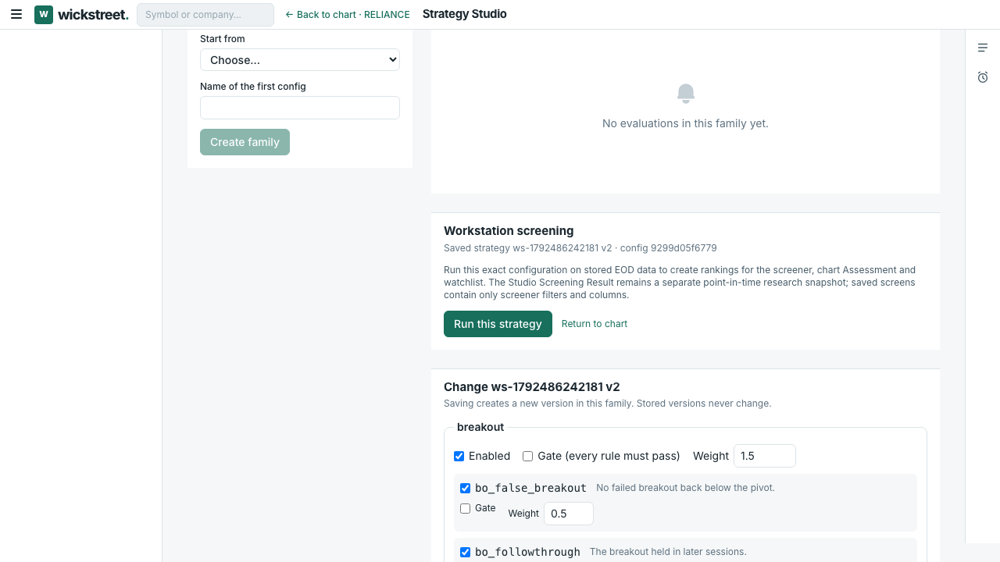
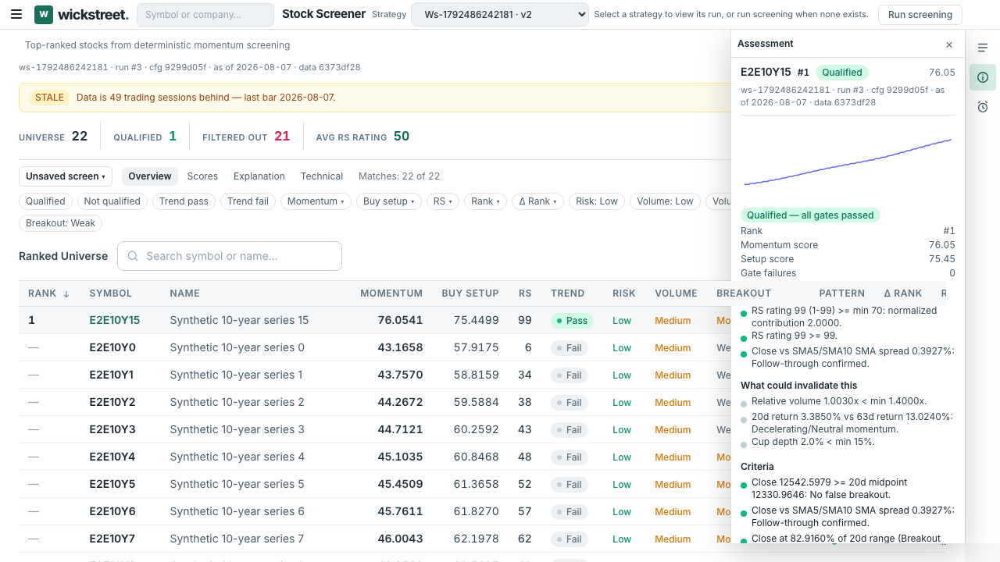
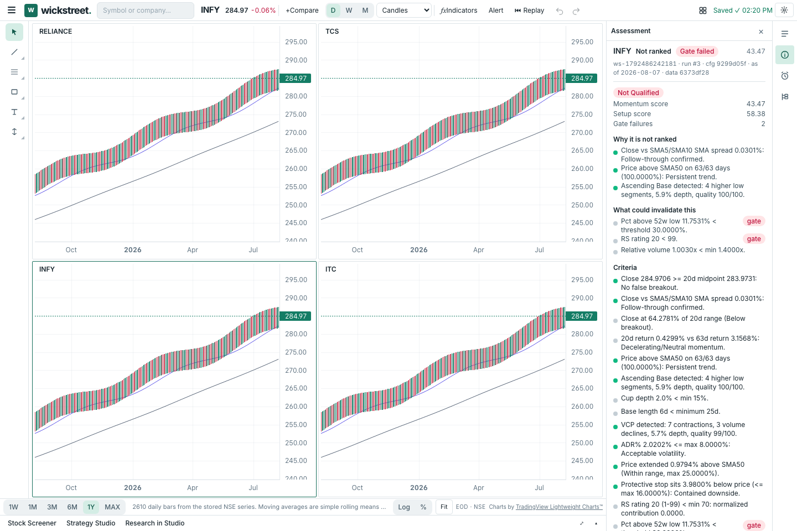
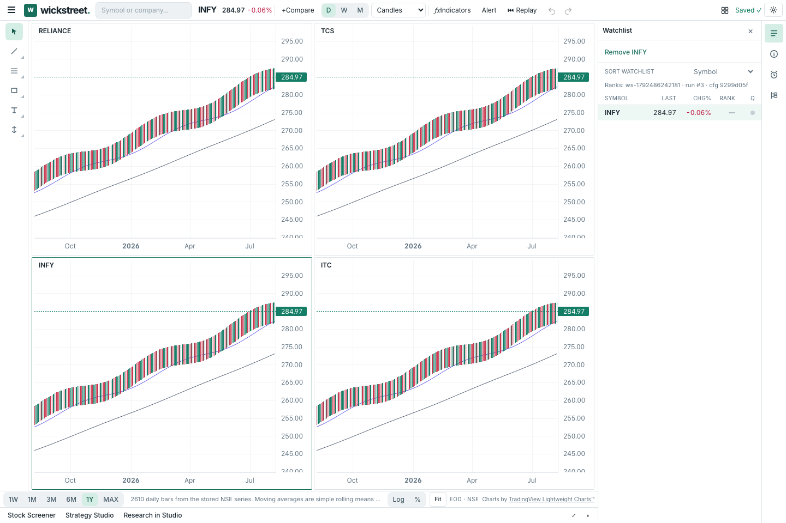
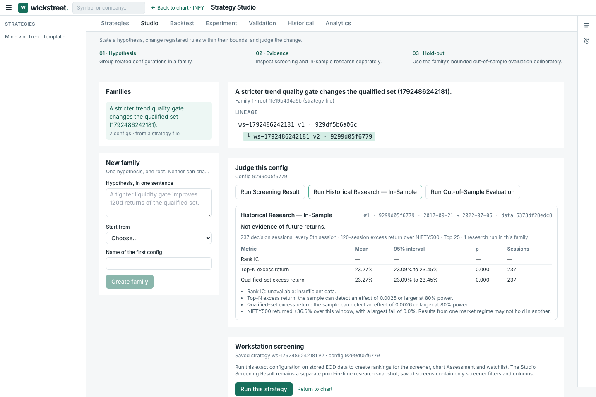
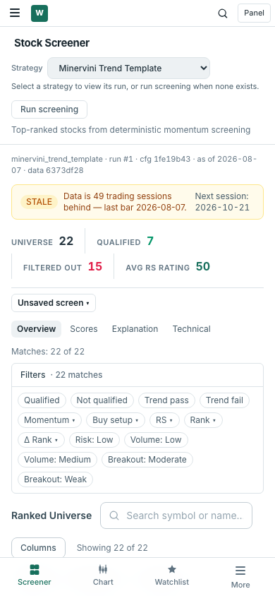
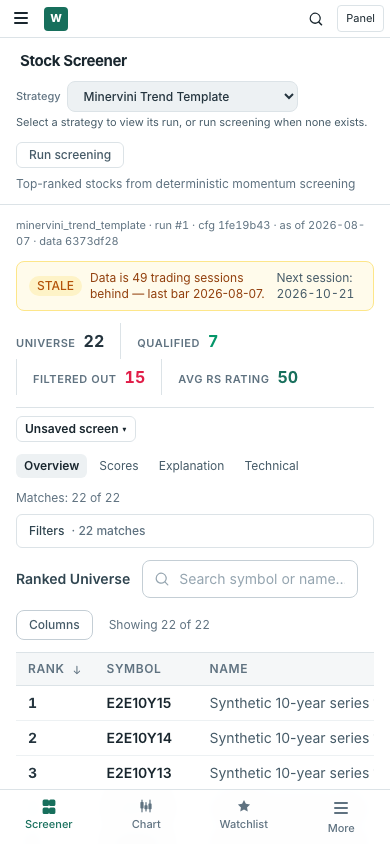

# Momentum25 Strategy Integration Report

**Decision: PASS** for the scoped Strategy Studio → screening → chart Assessment → watchlist → point-in-time research → return workflow.

The sign-off run used the real Wickstreet React/Vite app, FastAPI backend, and Postgres in Chromium against a fresh, isolated `_e2e` database containing only synthetic daily bars. Direct exchange downloads were disabled. Browser evidence and the automated suite refer to source revision `5e5c904`; the report and images are packaged separately in a documentation-only local commit.

## Capability matrix

| Capability | Result | Evidence / limit |
|---|---|---|
| Predefined strategy access | Verified | The seven registered strategy files remain available to their existing research surfaces. Minervini is the sole `production` strategy; six are deliberately `research` kind. |
| User strategy authoring | Verified | The Studio created a family from Minervini, changed the registered `tt_rs_rating_min` floor from 70 to 99, saved v1/v2, reloaded them, and retained distinct config hashes. |
| Config validation and save conflicts | Verified | The UI refused 100 outside the rule’s 1–99 bound. Duplicate hypothesis and built-in-name conflicts returned 409; versions were not overwritten. Editable fields remain limited to the declared registry. |
| Engine execution and rankings | Verified | The selected v2 config ran through the actual EOD screening pipeline. Its 99 RS threshold appeared in backend explanations and determined qualification and rank. The same run was then used by Screener, Assessment and Watchlist. |
| No-run selection / switching | Defect corrected | An unrun v1 remained selectable and showed an actionable run action. Switching from a completed run to v1 used to retain the previous table; the page now displays rankings only when their run ID matches the selected run. |
| Saved screens vs strategy definitions | Verified | Saved-screen documents contain only `id`, `name`, `column_set` and `filters`; changing strategy did not mutate the document. |
| Chart, Assessment and Watchlist context | Verified | A 2×2 workspace retained RELIANCE, TCS, INFY and ITC through Studio/research navigation and a full reload. The active INFY Assessment and watchlist row named the same strategy hash, run, as-of date and data version. |
| Historical research | Verified | The browser submitted an In-Sample evaluation from the selected saved config. It completed 237 decision sessions for 2017-09-21 through 2022-07-06 and wrote to `strategy_evaluations`, without adding a live screening run. The result is labelled “Not evidence of future returns.” |
| Backtest, experiment and validation methods | Preserved and regression-tested | Existing generic research remains on built-in strategy files. The custom-strategy route now directs users to Studio rather than calling built-in-only APIs and returning 404s. Existing backtest and walk-forward API tests passed. |
| Out-of-sample safeguards | Verified in backend tests | Synthetic tests cover the one-per-family hold-out, unavailable/insufficient provenance, retry after interruption and hold-out immutability. This browser run did not spend a new family’s hold-out. |
| Mobile screener | Defect corrected | Filters now start in a disclosure on 390×844. The first result rows are visible above the fixed navigation; opening the disclosure reproduces the previous obstructed layout. |
| Unranked Assessment | Defect corrected | Failed/unranked instruments now show “Why it is not ranked”; the E2E checked INFY’s gate failures and confirmed “Why it ranks” was absent. |

## Run, ranking and research provenance

The isolated browser database contained 22 synthetic securities and one as-of date, 2026-08-07. The three completed runs below shared data version `6373df28edc8`:

| Run | Strategy/config | Rows | Qualified |
|---:|---|---:|---:|
| 1 | `minervini_trend_template`, hash `1fe19b43…` | 22 | 7 |
| 2 | `benchmark_a_pure_momentum`, `research` kind | 22 | 22 |
| 3 | User family v2, hash `9299d05f…`, RS floor 99 | 22 | 1 |

For each row in the user run, the browser test fetched the run-bound backend explanation and independently checked that the configured RS gate passed exactly when the returned RS value was at least 99; every failing gate had rank 0. Ranking API pages at offsets 0, 10 and 20 exactly reconstructed the full 22-row response. The UI’s three 10-row pages, symbol sorting, search filtering and saved-screen filter were checked against that same run.

The family remained append-only after research and a later save:

| Version | Config hash | Live run |
|---:|---|---:|
| v1 | `929df5b6…` | none |
| v2 | `9299d05f…` | #3 |
| v3 | `5209cc3e…` | none |

Both the In-Sample result and the Studio Screening Result stayed attached to v2’s `9299d05f…` hash after v3 was saved. The Screening Result was stored in `strategy_evaluations`; the browser confirmed the live `screening_runs` count did not increase when it ran.

The “1 of 7 strategies has a completed run” observation came from comparing one live production strategy with all seven strategy files, six of which are research-only. In the synthetic fixture, the benchmark run is also present in run history, but its `research` kind keeps it out of the production selector. The previous ratio therefore mixed selectable live strategies with research definitions. The selector now lists eligible production strategies and every saved user version, labels versions without a run, and no longer presents that ratio as a user-facing status.

## Browser walkthrough

All captures below were made by the committed Chromium E2E suite at `5e5c904`. The before/after mobile images use the same build and synthetic fixture; the before image opens the filter disclosure to reproduce the former always-expanded control state.

1. Create a hypothesis and v1 from Minervini, edit the allowed RS floor, save v2, reload, then screen that exact config. Invalid and conflicting saves are rejected.
2. Compare the custom run with Minervini, inspect sorted rankings and the exact config’s gate evidence.
3. Select INFY in chart c3 of a 2×2 layout, inspect its run-bound Assessment, add it to Watchlist, and open Strategy Studio research.
4. Run In-Sample research for the selected v2 config, return to INFY, and confirm all four chart cells survived navigation and reload.
5. Return to the Screener and inspect the mobile filter comparison.

| Before: expanded mobile filters | After: collapsed filters expose ranked rows |
|---|---|
|  |  |

## Automated verification

- **Chromium E2E:** 7 passed on a fresh synthetic `_e2e` database, including authoring/reload, real screening, different outputs, gate reference checks, API/UI paging and sorting, switching and empty state, multi-chart/workspace persistence, watchlist, Research handoff and return, In-Sample execution, research hash retention, saved-screen independence, and mobile reflow.
- **Backend focused regressions:** 74 passed across run-list isolation, strategy evaluation, universe admission, research services and metadata, backtest API, and historical walk-forward validation. These include point-in-time data-version replay and hold-out restrictions.
- **Web unit tests:** 141 passed across 20 test files.
- **Web lint:** passed with zero warnings.
- **Production build:** passed. Vite still reports the main JavaScript chunk above its 500 kB advisory threshold; bundle splitting was not part of this focused correction.
- **Python lint:** passed for all changed backend modules; `git diff --check` passed.

The browser data is deliberately stale relative to the machine date. The UI correctly shows the synthetic fixture’s latest bar as 2026-08-07 and marks it 49 trading sessions behind. This validates freshness messaging, not production market-data freshness or live latency. No investment-performance claim is made from the synthetic results.

## Corrections and local revisions

- `cecb3e5` — hash-pinned saved-strategy execution and native workstation integration, empty-state/stale-row protection, research routing, mobile filters and ADR-014 §9.
- `632e60d`–`5e5c904` — focused browser regression and evidence refinements, including run sorting, workspace reload persistence and the actual In-Sample browser flow.

No financial methodology, investment calculations, exchange downloads, production data or hold-out in a real data set were changed or used. No commits were pushed.

## Remaining limits

- Strategy Studio v1 exposes only registered engines, rules, gates, weights and bounded parameters. Universe, indicator, ranking and benchmark sections remain fixed to the parent; there is no user scripting.
- Six strategy files are research-kind definitions and cannot be run as production screeners. Promoting any of them requires an explicit product/methodology decision.
- User configs use Strategy Studio’s point-in-time research APIs. Generic backtest, experiment and validation tools remain tied to built-in strategy files by design; they do not silently reinterpret a user config.
- The full hold-out calculation was covered by isolated backend tests rather than spending a new hold-out in the browser run. No production-dataset benchmark, 200% zoom audit, tablet sweep or chart P95 benchmark was part of this focused sign-off.
