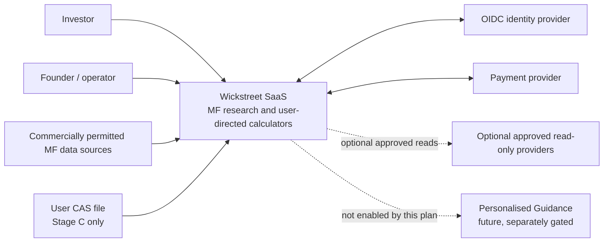
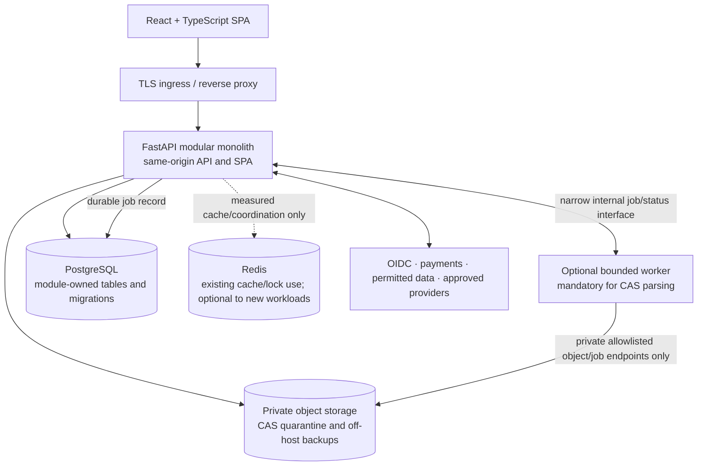
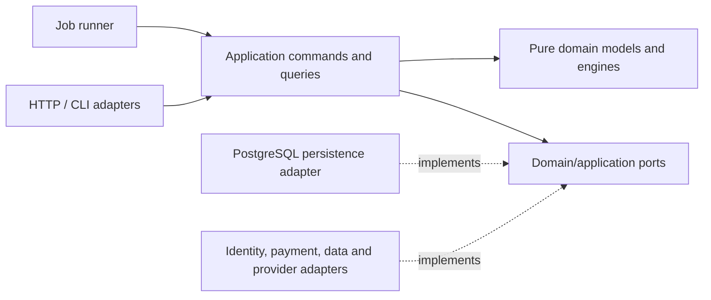
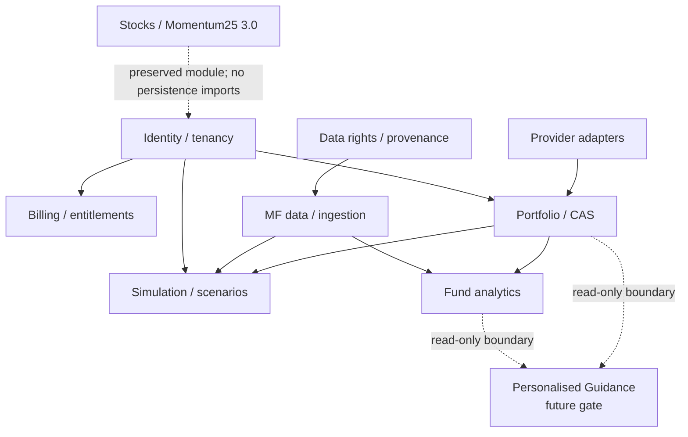

# ADD Amendment A3 — Wickstreet Target Architecture

> **Status: Accepted 2026-10-22.** The owner approved this target architecture subject to the C1 egress-wording correction in §14; that correction has been applied and verified. This is the single target architecture for Wickstreet 2.0/3.0. Acceptance does not authorize implementation, infrastructure expenditure, data ingestion, CAS intake, registration, commits or pushes.
>
> **Authority:** This amendment governs Wickstreet's product boundary, staged capability delivery and deployment direction. Existing Momentum25 and stock-market capabilities remain protected by the Capability Preservation Invariant in §3.2. A3 does not rewrite historical ADRs. The scoped ADR-010 supersession in §13 is effective upon this acceptance.

## 1. Purpose and executive decision

Wickstreet should evolve as a **modular monolith** using the existing Python/FastAPI backend, React/TypeScript frontend, PostgreSQL database and Docker-based development topology. Maintain domain boundaries in the current codebase; do not introduce microservices, Kubernetes or a message broker without measured workload or isolation requirements.

Wickstreet 2.0 delivers mutual-fund research and user-directed calculators before CAS integration. CAS processing, portfolio-linked analytics and advanced rebalancing simulations form a later capability stage. Personalised investment guidance is a separately gated future capability. Wickstreet 3.0 retains existing stock intelligence, charts, Momentum25, Strategy Studio, screening, research and backtesting capabilities.

Development continues on existing infrastructure and synthetic fixtures at **₹0 incremental hosting cost**. Founder-led operations and staged infrastructure spend follow actual customers, traffic, data volume, legal duties and support load. A service boundary is not a requirement to create a separate process or service today.

## 2. Repository evidence and current-state assessment

This assessment was checked against the implementation and canonical release plan in October 2026. The repository contains:

- Python 3.12, FastAPI, SQLAlchemy async sessions, Alembic migrations and domain/application/infrastructure/interface packages.
- React 18, TypeScript and Vite; React Router, TanStack Query/Table and Lightweight Charts. The built SPA is served by the API from the same origin.
- PostgreSQL 16 and Redis 7 in Docker Compose. The current Compose API container runs one process and APScheduler. Compose runs migrations at API startup.
- 25 Python Alembic migration files, immutable/versioned research records, point-in-time data revisions, structured logging and Prometheus metrics.
- Import-linter contracts for some layer boundaries; PostgreSQL repositories are wired directly by FastAPI composition dependencies in several places.
- A single-user, unauthenticated product bound to loopback by default. `get_current_user()` returns a singleton anonymous principal. Nullable `tenant_id` columns cover only selected models and queries do not implement general tenant isolation.

The clean domain core, deterministic run/evaluation history, same-origin chart workstation, PostgreSQL/Alembic investment and synthetic test practice are retained. Persistence abstractions are partial: the domain has useful repository protocols, but application use cases and database mappings are not fully separated across every capability. The repository has PostgreSQL-specific JSONB, conflict handling, triggers, sequences and history functions. A persistence port limits coupling; it does not promise a painless database replacement.

`docs/current/architecture.md` is an as-built snapshot and has details that should be reconciled with code when that document is next updated. A3 is the target direction, not an assertion that these SaaS controls already exist.

## 3. Product and capability boundaries

### 3.1 Wickstreet 2.0 product boundary

The platform may calculate the consequences of choices made by the user: chosen schemes, allocation weights, amounts, timing, goals, return assumptions and rebalancing rules. It must not choose those inputs for the user, select a fund as suitable, prescribe a target allocation or issue buy/sell/switch instructions.

For 2.0, avoid profile-selected defaults, automated fund replacement, optimisation, “best for you” rankings, recommended portfolios, and action nudges. State assumptions, calculation method/version, data dates, missing coverage and limitations. Disclaimers do not change the product's actual classification.

### 3.2 Capability Preservation Invariant

**All existing Momentum25 and Wickstreet stock-market capabilities, including their domain engines, APIs, persistence, charting, strategies, research, screening, backtesting and saved workspaces, must be preserved. The Wickstreet 2.0 MF-first release may hide or defer their exposure in the commercial interface, but must not delete, disable, regress or irreversibly alter these capabilities. Any future replacement or deprecation requires explicit owner approval and regression verification.**

Keep current stock code, data and migration history, strategy identities including `strategy_id=30`, manifests, historical runs, chart features, sealed hold-out and accepted ADR records intact. No MF module may import or mutate Momentum25 persistence internals. MF/stock interaction uses explicit read contracts and versioned data where required.

### 3.3 Personalised Guidance extension point

Reserve a separate **Personalised Guidance** bounded context at the product and API boundary. It is not part of the MF research/simulation launch, and no recommendation engine, recommendation endpoint, profile-based allocation or regulated workflow is implemented by A3.

If pursued later, Guidance consumes approved read interfaces for user-authorized profile/portfolio facts and market analytics, then returns a separately governed advice artifact. It must not be smuggled into Simulation or Analytics. Before any live guidance, the owner must approve a fresh workflow-level IA/RA classification, commercial model, applicable registration/partner arrangement, eligibility, compliance and operational cost, user agreements and launch gate. No IA path or cost is presumed by this architecture.

## 4. Staged capability roadmap

These stages describe product capability and operational exposure. They do not require separate services. Each gate needs separate implementation authority.

| Stage | Product and architecture scope | Required gate before exposure |
|---|---|---|
| **A — Development** | Existing infrastructure, synthetic fixtures, existing code and ₹0 incremental hosting. Build/test new MF calculations on fixtures only. No production customer data. | None beyond repository controls and approved methodology for future implementation. |
| **B — Initial SaaS** | Authenticated MF discovery, factual comparison and permitted datasets; subscription/entitlement boundary; basic user-directed SIP/lumpsum/goal calculators with user-entered fund and assumptions. | Written commercial data permissions per use before affected data is ingested/published; real identity, privacy, billing, security and recovery controls before customer accounts or payments. |
| **C — Portfolio Intelligence** | CAS upload/import, accounting, XIRR and diagnostics, portfolio-linked scenarios, saved comparisons and advanced user-authored rebalancing. Optional provider-approved read-only portfolio connections remain separate. | Dedicated isolated CAS parser worker, tenant controls, consent/retention/deletion, secure backup/restore and scoped independent security review before real CAS. Provider permission and separate approval before integrations. |
| **D — Growth and Wickstreet 3.0** | Evidence-driven capacity changes; existing stock intelligence, charting, Momentum25, Strategy Studio, screening, research and backtesting remain available and preserved. | Service or data-store separation only for measured scaling, security, reliability or ownership need. Existing capabilities require regression verification for any integration. |

Personalised Guidance is a separate future gate and is **not** a Stage D commitment. It may only proceed after its own regulatory, commercial and product approval.

### 4.1 Release and paywall rules

The Free tier can include comprehensive fund discovery, factual screening and comparison, historical NAV/returns/risk/costs, and factual holdings/overlap where data permissions allow. Basic Pro calculators can be offered before CAS; they require deliberate user selection and assumptions. CAS-dependent XIRR, portfolio diagnostics and portfolio-linked rebalancing wait for Stage C. Provider integrations are optional and do not gate 2.0.

Do not require CAS, broker connectivity, advanced portfolio analytics or all bounded contexts to validate the initial research/calc offer. If the basic paid calculators do not provide enough value, test willingness to pay for research/reporting before expanding scope; do not imply personalised guidance in marketing.

## 5. Domain decomposition

Each module owns its domain rules, public application interfaces and persistence mappings. Other modules use those interfaces and opaque identifiers; they do not access another module's ORM models, tables or repositories directly.

| Bounded context | Responsibilities and owned data | Public interaction and transaction | Extraction potential |
|---|---|---|---|
| **Identity and tenancy** | Principals, tenants, memberships, roles and account lifecycle. | Verified auth adapter supplies tenant context to use cases; clients cannot choose tenant scope. Identity changes are local transactions. | External OIDC provider from Stage B; internal service extraction only if operational need. |
| **Subscription and entitlements** | Plans, subscription status, payment event ledger and feature grants; no card data. | Provider webhook adapter verifies signature; idempotent event record and entitlement update. | High, but keep in monolith until billing needs independent operation. |
| **Data rights and provenance** | Dataset/source permissions, permitted uses, evidence, cutoff, retrieval/storage/display/history/export rights and revision provenance. | Policy query gates ingestion and publication; unknown/denied permission fails closed. | Medium; separate only if data suppliers and operations gain independent lifecycle. |
| **MF reference data and ingestion** | Scheme identity, NAV/holdings observations, batch validation, source revisions and ingestion jobs. | Read contract to Analytics/Simulation; import command/adapter for early stages. Batch writes are atomic and idempotent within the defined batch. | High: independent schedules, workload and supplier rights make it a natural future worker/service. |
| **Portfolio and CAS** | Upload metadata, parsed transactions, holdings, accounting, XIRR and descriptive diagnostics. Private tenant-owned records. | CAS job result is validated and committed inside a tenant-scoped transaction. Exposes explicit read/query contracts to Analytics/Simulation. | High when isolation, volume or privacy operations justify it. |
| **Fund Analytics** | Descriptive returns, risk, cost, overlap and factual comparison. Versioned derived results. | Synchronous queries for bounded reads; expensive refresh jobs use a durable job boundary. No writes to portfolios or advice. | Medium/high if shared-data query load grows independently. |
| **Simulation and scenarios** | Pure user-directed calculations, scenario inputs/results, method versions and reproducibility metadata. | Pure calculation function; save inputs/result in one application transaction. Reads versioned scheme/NAV facts through ports. | High if CPU or latency is independently constrained. |
| **Provider integrations** | OIDC, payments and optional read-only broker adapters, credentials and provider event processing. | Vendor contracts sit behind adapters. OAuth scopes are least-privilege; tokens are encrypted. Provider failures do not corrupt portfolio state. | High due to separate secrets, rate limits and external failure modes. |
| **User research and workspaces** | Saved research/scenarios and preferences not owned by another module. | Tenant-scoped use cases and optimistic revision checks. | Medium; combine with owning capability until ownership proves otherwise. |
| **Stocks / Momentum25 (3.0)** | Existing market ingestion, charts, screeners, strategies, research and run history. | Existing APIs and persistence remain under current ownership. Any cross-release read is an explicit contract. | Future option only; no extraction required for MF 2.0. |
| **Personalised Guidance (future)** | Separately governed profile assessment and advice artifacts, if approved. | Not implemented. If approved, its own application interface, policy and compliance workflow; may call read-only Portfolio/Analytics interfaces. | Could be isolated for regulatory and audit boundaries, but no service commitment now. |

### 5.1 Dependency and communication rules

Application use cases call domain services and narrow repository/provider ports. Interface adapters map HTTP/CLI requests to commands and DTOs. PostgreSQL and external adapters implement ports. Shared Python utility modules contain no domain policy. A module must not reach into another module's persistence adapter.

Use synchronous in-process calls for small reads and bounded calculations. For work that must survive process restart, store a durable job before acknowledging it. A small PostgreSQL-backed job table and a separate worker process are sufficient initially; Redis remains optional for existing cache/coordination needs. Add an outbox only when a committed change must reliably fan out to another process/provider. A message broker is a later option, not a prerequisite.

One transaction belongs to one module command and one unit of work. Repositories do not commit independently; the unit-of-work boundary commits or rolls back. Cross-module consistency uses stable IDs and, only when necessary, an outbox event/projection—not shared table writes or long distributed transactions.

## 6. System and component diagrams

### 6.1 System context

### 6.2 Container view

### 6.3 Component boundaries

### 6.4 Module dependency rule

## 7. Database, persistence and data ownership

### 7.1 PostgreSQL first; narrow ports

Keep PostgreSQL as the initial and intended shared database. Domain entities/value objects remain independent of SQLAlchemy models. Define repository protocols around actual use-case needs, such as `ScenarioRepository.get(tenant_id, scenario_id)` and `PortfolioLedger.append(tenant_id, entries)`, rather than a generic database framework. Adapters translate between domain types and PostgreSQL rows. A `UnitOfWork` owns session and transaction lifecycle.

New tables and migrations have one declared owning module. Preserve the existing Momentum25 schema and migrations; do not force a disruptive schema reorganization before MF launch. Cross-module access goes through application query interfaces, not ORM joins constructed by unrelated modules. Cross-module foreign keys are avoided where they would make future extraction brittle; foreign keys within a module remain appropriate.

PostgreSQL-specific features may be used deliberately inside its adapter where they support atomicity, uniqueness, concurrency or history. SQLAlchemy does not neutralize database-specific behaviour. A future PostgreSQL-to-other-database move entails schema/data export, query and trigger rewrites, transaction and isolation review, constraint recreation, historical reconciliation, cutover rehearsal and restore testing. It is not an adapter-only change.

### 7.2 Consistency, history and deterministic records

- Keep financial units, amounts, NAV and outputs at explicit precision with documented rounding.
- Treat public market observations as source/revision data; derived analytics store calculation version and source revision.
- A simulation records normalized user inputs, engine/method version, source-data revision and cutoff, assumptions, coverage, rounding rules and output hash. Identical inputs and versions reproduce identical results.
- Use optimistic concurrency for saved scenarios, modeled on the existing workspace document revision/ETag contract.
- Tenant-owned data carries owner scope in every repository operation. A client-provided tenant ID is never authorization.
- CAS import creates an auditable import batch; corrections do not silently overwrite the user's source record. Retention and deletion policies must be explicit.

### 7.3 Query, connection and migration policy

Add indexes from observed query plans, not speculative coverage. Candidate access paths include scheme/date for NAV series, tenant/updated time for owner lists and job state/created time for claims. Use `EXPLAIN (ANALYZE, BUFFERS)` on representative fixtures before adding indexes. Keep connection-pool limits explicit across all API and worker processes; total pools must fit the database connection budget. Use short transactions and one independent `AsyncSession` per concurrent task.

Use Alembic migrations as the schema change record. Run migration checks on the current baseline; separate migration execution from application replica startup. Each production migration needs an expand/migrate/contract plan if it cannot be applied atomically without downtime. PostgreSQL read replicas, partitioning, TimescaleDB, separate databases and connection poolers remain evidence-gated options.

## 8. Technology and API decisions

| Technology/boundary | Decision | Consequence / alternative |
|---|---|---|
| Python 3.12 + FastAPI | Retain | Reuse domain engines and existing API; isolate bounded CPU and parsing workloads. Rebuilding in another framework has no demonstrated benefit. |
| React + TypeScript + Vite | Retain | Preserve chart workstation investment, same-origin delivery and generated API schema. |
| PostgreSQL + SQLAlchemy + Alembic | Retain | Strong transactional and history fit; PostgreSQL-specific implementation remains explicit. |
| Redis | Retain existing use; optional for new MF workloads | No new cache/queue dependency unless measured need exists. Database remains source of truth. |
| Docker Compose | Retain for local and initial single-host topology | Not a high-availability platform; add separate worker only for job safety/load, TLS/recovery around production. |
| API | Keep `/api/v1`, same origin, OpenAPI-generated frontend types | Add compatible endpoints; new API version only for an approved breaking contract. Derive tenant from verified session. |
| Background execution | Synchronous for bounded calculator operations; durable jobs for restart-sensitive work | FastAPI in-process background tasks are not the durable job boundary. CAS parsing always uses the isolated worker. |
| Caching | Existing cache where useful; cache only versioned public analytics initially | Private cache entries require tenant-aware keys and isolation verification. Correctness cannot depend on cache. |
| Eventing | No broker initially | Add transactional outbox only for reliable cross-process effects; broker after independent consumers/services exist. |

API error and DTO contracts should be stable, documented and generated into TypeScript. Maintain current chart/workspace semantics. Use idempotency keys or unique provider event IDs for billing and ingestion callbacks.

## 9. Authentication, tenancy and security

The current anonymous single-user instance remains suitable for local development only. Stage B requires production authentication before paid account state; Stage C requires tenant-scoped access before storing any real CAS-derived portfolio records. Use an established OIDC provider behind a provider adapter rather than implementing passwords/identity from scratch. Use secure HTTP-only same-site sessions, CSRF protection for state-changing requests and explicit authorization checks.

Tenant identity is resolved from the validated principal at the HTTP boundary and passed as a typed application context. All reads/writes/exports/background jobs include that context. Add automated cross-tenant denial coverage for every private aggregate. PostgreSQL Row-Level Security may provide defense in depth for tenant-owned tables: application role must not be owner or have `BYPASSRLS`; set tenant context transaction-locally and test under the production role. RLS does not replace application authorization.

Minimum exposure controls include TLS, private database networking, secrets outside images, least-privilege service roles, request/file size limits, rate limiting appropriate to deployment topology, structured logs without CAS contents or tokens, audit-relevant account/payment/import events, dependency updates, deletion/export handling, and encrypted backups. Stage requirements and security review scope are proportionate to exposure; enterprise SOC or multi-region operation is not a launch default.

### 9.1 CAS processing isolation (mandatory for Stage C)

CAS files are untrusted financial documents. Before enabling intake:

1. Authenticate and authorize upload; enforce allowlisted format, byte/page limits and tenant quota.
2. Write to a private quarantine location with generated object key and short retention. Do not parse in the API process or store upload bytes in public web storage.
3. Dispatch a durable job to a dedicated non-root parser container/process. Apply CPU, memory, wall-time and temporary-disk limits; read-only base filesystem; no general internet egress; only narrowly allowlisted private object-storage and job-status endpoints; no provider credentials or general application DB credentials; isolate parser dependencies.
4. Validate parser output against a strict schema and expected owner/job. Stage the normalized result privately; the application validates and commits ledger records in one tenant-scoped transaction. The parser reports through a narrow internal job interface and does not claim arbitrary jobs or query business tables.
5. Record parser/mapping version, import status, source hash and user correction/confirmation. Prevent sensitive content in logs, traces, error reports and analytics.
6. Delete/quarantine raw uploads according to the approved retention choice and deletion workflow. Backups must have a defined expiry and deletion approach.

This dedicated worker is mandatory for CAS even at low throughput. It is a security boundary, not a commitment to Celery, a broker or a distributed microservice architecture.

## 10. Reliability, recovery and operations

### Stage A — Development

Use existing local infrastructure and synthetic fixtures at ₹0 incremental hosting cost. Do not use real customer CAS or production credentials. Preserve founder-owned architecture/security operations and legally supervised intern work on synthetic data.

### Stage B — Initial SaaS

Use a separate production deployment, initially one small host/Compose topology where suitable: TLS ingress, one API instance, private PostgreSQL, production secrets, firewalling and encrypted off-host backups. Run schema migrations as a release step, not simultaneously from multiple API replicas. Keep founder-operated health checks and low-cost alerting for availability, 5xx rate, disk, database connections, backups and billing/provider webhook failures. Paid monitoring/SRE packages are not implicit requirements.

Set owner-approved RPO/RTO before private portfolio data. A proposed starting point for review is RPO ≤24 hours and RTO ≤8 hours, supported by encrypted off-host backups and a rehearsed restore. A local named Docker volume alone does not meet this. Point-in-time recovery adds WAL archive operations and should be used when actual recovery needs justify its cost/operations.

### Stage C — Portfolio Intelligence

Deploy the bounded CAS worker and private object quarantine. Monitor job backlog, parser failures, resource limits and tenant deletion completion. Keep the worker in the same codebase/image initially, with separate credentials, command and runtime limits. It may later become independently deployable without moving its domain logic.

### Stage D — Growth

Scale API replicas, worker count, PostgreSQL capacity, object storage and monitoring individually as measured. Do not scale all containers together by default. Keep deployment process, runbooks, incident response and restore skills within actual founder capacity; add operational help only with separate budget and owner approval.

## 11. Performance measurement and scaling gates

The earlier 25 requests/second and 100 concurrent clients are **load-test scenarios**, not production acceptance criteria or an automatic scale trigger. Establish the baseline and owner-approved SLOs in a staging-like environment using synthetic but representative request mixes and realistic data volume.

Run a ramped load sweep (for example 1, 5, 10 and 25 requests/second, with up to 100 concurrent clients as a stress point), then a burst and soak phase. Include public fund reads, comparisons, basic calculators, authenticated writes, deliberately slow external provider responses, worker tasks and database pool limits. Record p50/p95/p99 latency, error rate, CPU/memory, DB pool wait, SQL query time, disk growth and job queue wait. The scenarios are adjustable; passing the largest point is not required unless the measured product need calls for it.

Before launch, owner and operator agree service objectives from expected use and measured capacity. Consider scaling or extraction only after an agreed objective is repeatedly missed after query/index and code review, resource headroom is insufficient for measured peak, job completion misses its accepted deadline, or a separate security/availability boundary requires it. Subscriber count alone does not trigger scale-out.

Candidate measurement signals are sustained API CPU/memory, database connection acquisition wait and saturation, query plans, object storage growth, CAS worker limit events, queue wait/completion and founder support/incident hours. Record observation windows and business impact before changing topology. Partitioning, read replicas, managed services and independent services require a written bottleneck and an owner for the new operational surface.

## 12. Future extraction strategy

Keep domain logic in the module and define the extraction seam before any service split: application interface, versioned request/result contract, owned data, idempotency rule, operational SLO and migration/rollback plan. Extract only one workload at a time.

Likely candidates when justified:

- **CAS parser:** first isolated worker due to untrusted input, with no direct DB access.
- **MF ingestion:** separate worker or service if supplier cadence, volume or permissions need independent operations.
- **Simulation processing:** worker first if compute affects interactive response; separate service only if independent capacity or release needs persist.
- **Portfolio management:** separate only for independent privacy/availability boundaries or load; tenancy and ledger domain remain portable behind their application contracts.
- **Fund analytics:** separate read model only if public-data query load materially competes with transactional portfolio work.

Microservices require separate deployment, authentication, observability, recovery, data ownership and support. Without operational ownership, extraction is a net cost. A service split still requires data/query/transaction migration; it is not just a network call replacement.

## 13. Existing ADR and plan treatment

No accepted ADR text is rewritten by A3. The following scope applies upon A3 acceptance:

| Record | A3 treatment |
|---|---|
| ADD and A1 | Retain historical decisions and accepted Wickstreet charting direction. A3 governs the 2.0/3.0 staged SaaS target where they conflict. |
| ADD A2 and ADR-016–021 | Keep their history/status. Align future MF implementation with the canonical release plan and module boundaries in A3 before approving related code. |
| ADR-010 | Its historic assumption that a singleton anonymous principal and nullable `tenant_id` columns are sufficient “SaaS seams” is superseded by accepted A3. Authentication and tenant isolation are launch gates before private customer data. Preserve ADR text as history; no data or code changes are implied. |
| ADR-007 | Keep in-process scheduler for its current single-instance job. It does not imply durable processing for long jobs; Stage C CAS has its own isolated worker requirement. No scheduler replacement is required now. |
| ADR-004 | Retain PostgreSQL. A3 clarifies that persistence ports contain coupling but do not make a different database an adapter-only migration. No DB switch or TimescaleDB work is authorized. |
| ADR-001, 002, 008, 009, 011, 013/013a/013b, 014 | Preserve. Their stack, dependency direction, API, deterministic results, charting and research-history investments remain in force subject to the capability invariant. |
| ADR-012, 015 and other proposed ADRs | Keep their existing proposed status. A3 acceptance does not silently accept them. |

The canonical release plan remains the product and sequencing source for Wickstreet 2.0/3.0. A3 supplies the target architecture and must link back to that plan.

## 14. Incremental roadmap and acceptance criteria

No item below authorizes implementation. Each milestone requires its own explicit authority.

| Milestone | Acceptance evidence |
|---|---|
| **A0 — architecture baseline** | A3 accepted; as-built module, API and persistence inventory linked to current code; ADR-010 supersession effective; preservation invariant recorded. |
| **A1 — module contracts** | Ownership map for MF, portfolio, analytics, simulation, identity, billing and existing stocks; no cross-module ORM imports; layer/module rules enforced in CI; API/OpenAPI contract generated. |
| **B1 — SaaS foundation** | Production auth and session handling; no client-selected tenant authorization; cross-tenant tests cover reads/writes/exports; subscription webhooks are verified/idempotent; security review scope and backup/restore evidence approved before applicable exposure. |
| **B2 — MF research and basic calculators** | Synthetic tests reproduce calculations; permitted data records source/use/cutoff; no recommendations/defaults; billing entitlements tested; performance baseline and owner-approved SLO recorded. |
| **C1 — CAS isolation** | Parser runs in a dedicated bounded environment with no unrestricted or public internet egress, only explicitly allowlisted private endpoints, and no general application database credentials. Acceptance also verifies malformed/oversized/adversarial fixtures fail safely, deletion and retention flows, and no raw content in logs. |
| **C2 — portfolio and advanced simulations** | Ledger/XIRR reconciles to reviewed examples; tenant isolation and transaction boundaries pass; scenarios persist method/input/data revisions and replay deterministically; reconciliation and correction cases documented. |
| **D1 — scale or extraction review** | Evidence of sustained SLO/resource/security need, tested module contract, migration/rollback, cost and named operator. No service extraction based solely on subscriber targets. |
| **D2 — Wickstreet 3.0 integration** | Regression evidence for existing APIs, domain engines, persistence, charts, strategies, research, screening, backtesting and saved workspaces; no removal/deactivation; separate owner approval for any deprecation. |
| **Future Guidance gate** | Separate legal/regulatory classification, operating model, economics, product owner approval and compliance launch gates. No recommendation code/API before approval. |

## 15. Risks and mitigations

| Risk | Mitigation |
|---|---|
| Advice emerges through defaults, ranking, wording or nudges | Keep simulator user-controlled; review actual UI, API, notifications and reports. Guidance has a separate future gate. |
| Tenant leakage through unscoped legacy queries | Do not expose legacy single-user paths to SaaS until scoped; derive tenant from identity; test all private paths; use RLS as additional defense. |
| CAS parser compromise or resource exhaustion | Isolated worker, no general internet egress/DB secrets, bounded resources, strict schema validation, quarantine and short retention. |
| MF source permission does not cover commercial display/history | Rights register with use-specific evidence and fail-closed publication; support fixture-only calculators and feature narrowing. |
| Founder operations exceed capacity | Instrument support/job/incident time; set account/job intake caps; spend or pause based on observed capacity. |
| Postgres abstraction overpromises portability | Keep PostgreSQL; state migration work explicitly; build alternate adapters only against actual module ports and a concrete need. |
| Old stock-first documents lead to accidental changes | Canonical plan and A3 define current direction; historical plans remain marked superseded; CI/regression gates protect existing capability. |

## 16. Owner decisions and acceptance

This accepted architecture records the following direction:

1. Keep the existing stack and modular monolith.
2. Deliver MF research and basic user-directed calculators before CAS.
3. Require isolated CAS parsing before Stage C file intake.
4. Treat load figures as test scenarios; set production objectives from measured baseline and approved service needs.
5. Keep Personalised Guidance future-only and separately gated.
6. Preserve all stock/Momentum25 capabilities under the invariant in §3.2.
7. Preserve ₹0 incremental development hosting, founder-led operations and demand-triggered spending.

**A3 is Accepted:** it is the target architecture for Wickstreet 2.0/3.0, and its specific ADR-010 supersession is effective. No implementation, infrastructure expenditure, data onboarding or deployment is authorized by this acceptance; those actions still require separate owner authority.

## 17. Later accepted extensions (2026-10-23)

This section records owner decisions taken after A3's acceptance. The text above is unchanged.

- **Research Agent.** [ADR-022](adr/ADR-022-multilingual-research-agent.md) adds a Research Agent bounded context to §5. It adds `Research Agent → {Analytics, Scenarios, MF data (read), Workspaces, Rights, Entitlements}` to §6.4; nothing depends on the agent. Model calls are a new egress path, governed by ADR-022 §2.8.
- **Operating modes and package.** [ADR-023](adr/ADR-023-operating-modes.md) runs one core in personal and SaaS modes. MF code lives in the `wickstreet` package, with its own PostgreSQL schema and Alembic environment. Momentum25 is unchanged (§3.2).
- **Phase and stage.** Phase 1 personal mode is a Stage A deployment on the owner's machine. It holds the owner's own records and only the data ADR-022 §2.11 permits. It holds no other person's data. Phase 2 SaaS starts at Stage B, and every Stage B gate in §4 still applies.
- **MF data foundation.** The [ADR-017 2.0 realignment](adr/ADR-017-funds-etfs-holdings.md#wickstreet-20-realignment-accepted-2026-10-23), accepted by the owner on 2026-10-23.
