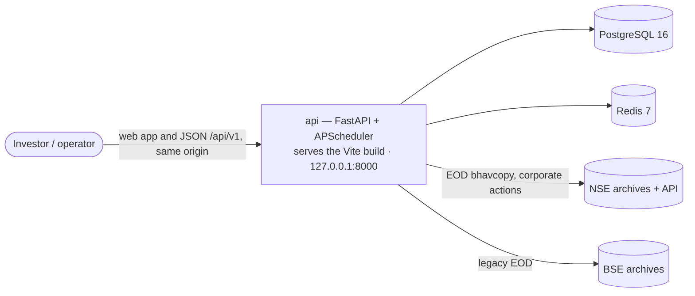

# Architecture — as built

Verified against the code on branch `wickstreet/m10-m11` (M10) on 2026-10-18.

The approved blueprint is the [ADD](../architecture/ADD.md) and its [ADRs](../architecture/adr/). This page says what the code does today, and where it differs from that blueprint. When this page and the ADD disagree, the ADD still governs. The differences in [Drift from the ADD](#drift-from-the-add) need a decision.

## System

Docker Compose runs three services: `db`, `redis`, `api`. One image (root `Dockerfile`) builds the web app with Node and serves it from the API at `/`, so the browser calls `/api/v1` on the same origin (ADR-013). Every published port binds to `127.0.0.1`; `APP_BIND` opts the app port in to LAN access (ADR-012). `make up-dev` adds Adminer (8080) and RedisInsight (5540). The `api` container runs migrations on start. One process serves HTTP and runs the scheduler (ADR-007).

## Layers

Hexagonal architecture (ADR-001). Code lives in `backend/src/momentum25/`.

| Layer | Package | What it holds |
|---|---|---|
| Domain | `domain/` | Entities, value objects, ports, the 8 evaluation engines, pattern detectors, strategy engine, scoring, ranking, explainability, walk-forward backtest math (`backtest/`), Elliott Wave and chart-pattern analytics (`analytics/`), research math (`research/`: forward returns, data quality, stop-loss, swing targets, survivorship). No I/O. |
| Application | `application/` | Use cases (`use_cases/`, `use_cases/research/`), DTOs, two shared services (`services/corporate_actions.py`, `services/rs_ratings.py`). |
| Infrastructure | `infrastructure/` | SQLAlchemy models and repositories, Alembic migrations, NSE/BSE/Kite providers, NSE trading calendar, indicator and RS pipelines (pandas/numpy), Redis cache/lock/refresh gate, APScheduler, settings, structlog, Prometheus metrics, tracing, retry/circuit breaker. |
| Interface | `interface/` | FastAPI routers (15), dependency wiring, error handlers, middleware (including the `Host`/`Origin` guard), web-app serving (`api/spa.py`), input validation, Typer CLI, walk-forward wiring shared by CLI and API. |
| Composition | `main.py`, `app/services/` | App factory, startup/shutdown, daily job. `app/services/` holds the screening job and a bulk market-sync service. |

### Enforcement

`lint-imports` checks two contracts in `backend/pyproject.toml`:

1. Layers: `interface` → `application` → `domain`.
2. `domain` imports nothing from `application`, `infrastructure` or `interface`.

Both pass today (2 kept, 0 broken). The contracts do not cover `infrastructure` or `app`, and CI does not run `lint-imports`. Run it by hand: `cd backend && .venv/bin/lint-imports`.

## Data stores

**PostgreSQL** (ADR-004). 18 tables, 14 Alembic migrations (`0001` → `0014`).

| Group | Tables |
|---|---|
| Instruments | `securities`, `bse_scrip_junction` |
| Prices | `ohlcv_daily` (current provider, 2019-09-30 →), `legacy_ohlcv_daily` (NSE archive, 1994-11-03 →, overlaps the current provider to 2024), `bse_legacy_ohlcv_daily` (BSE archive, 2006-03-01 → 2024-01-01), `benchmark_index_daily` |
| Corporate actions | `corporate_actions`, `corporate_action_inference_log` |
| Universe and survivorship | `historical_universe`, `survivorship_gap_event`, `universe_membership` |
| Strategy and runs | `strategies`, `screening_runs`, `screening_results`, `rule_results` |
| Validation | `forward_returns` |
| User | `watchlist_items`, `user_documents` (saved workspace and drawings, versioned by `revision`; ADR-013 §5) |

Run tables are append-only per `run_id` (ADR-006).

**Redis.** Universe RS-rating cache, a distributed lock, and a refresh cooldown gate. The API falls back to no cooldown when Redis is down.

**Strategy configs** are JSON files in [`docs/architecture/strategies/`](../architecture/strategies/). The API reads them at startup (`M25_STRATEGY_DIR`, default `../docs/architecture/strategies`) and syncs them into `strategies`. Do not move that folder without changing the setting.

## External data

| Source | Adapter | Use |
|---|---|---|
| NSE EOD bhavcopy (current) | `providers/bhavcopy.py`, `providers/nse_client.py` | Daily prices from 2019-09-30 |
| NSE legacy archive | research backfill use cases | Prices 1994-11-03 → 2019-09-29 |
| BSE bhavcopy | `providers/bse_bhavcopy.py` | Legacy prices and `POST /market-data/refresh` |
| NSE corporate actions API | `application/services/corporate_actions.py` | Split/bonus adjustment factors. API caps at 20 rows per symbol. |
| Zerodha Kite Connect | `providers/kite.py` | Adapter exists. Nothing calls it. |

## Configuration

All settings come from `M25_*` environment variables (`infrastructure/config/settings.py`). Key ones: `M25_DATABASE_URL`, `M25_REDIS_URL`, `M25_SCHEDULER_ENABLED` (default `false`; `.env.example` sets `true`), `M25_SCHEDULE_CRON` (default `30 18 * * 1-5`, Asia/Kolkata), `M25_STRATEGY_DIR`, `M25_ALLOWED_HOSTS` (host names the API answers to; default loopback), `M25_WEB_DIST_DIR` (built web app to serve; empty = API only). See [operations/deployment.md](../operations/deployment.md).

## Drift from the ADD

The ADD was written for a greenfield MVP (milestones M0–M8). The code has grown past it. These items differ from the approved blueprint. Each needs either an ADD amendment or a code change. None is decided yet.

| # | ADD / ADR says | Code does | Recommendation |
|---|---|---|---|
| D1 | Indicators are pure domain functions (ADD §10, §17). | Indicator math runs in `infrastructure/pipelines/indicator_pipeline.py` with pandas and reads the database. `domain/indicators/` holds only the port. | Amend the ADD to accept the pipeline as an adapter, or move the math into the domain. The second keeps the "pure core" claim true. |
| D2 | Out of scope: backtesting, BSE, advanced patterns (ADD §4). | Walk-forward backtest, BSE legacy data, cup-with-handle and ascending-base detectors all ship. | Amend ADD §4–§6 and §27 to record them. |
| D3 | Not in the ADD at all. | Elliott Wave analysis, chart-pattern analysis, validation and research APIs, watchlist, market context. | Amend the ADD. They are isolated research surfaces (see [design.md](design.md#research-isolation)). |
| D4 | Redis is a later SaaS step (ADD §24, ADR-007). | Redis is a required service for caching, locking and the refresh gate. | Amend ADR-007 or write a new ADR. |
| D5 | Gate engines count in the momentum score (ADD §21). | `ScoringEngineImpl` drops gate engines from both weighted scores. The docstring proves this is rank-neutral. | Amend ADD §21. |
| D6 | API: `GET /rankings/latest`, `GET /rankings/{run_id}` (ADD §14). | `GET /rankings/runs/{run_id}`; the latest run comes from `GET /runs/latest`. | Amend ADD §14 and IMPLEMENTATION_SPEC §5. |
| D7 | CLI commands `ingest` and `screen` (ADD §10). | Both print "implemented in milestone M1/M4" and exit. Runs go through the API or scheduler. | Implement or remove them. |
| D8 | Layers: domain, application, infrastructure, interface. | `app/services/` sits outside all four and no contract covers it. | Move it into `application` or `interface`, and add a contract. |
| D9 | Import contracts run in CI (README claimed this). | CI runs ruff, mypy, pytest, `npm run lint`, `npm run build`. Not `lint-imports`. | Add `lint-imports` to `.github/workflows/ci.yml`. |
| D10 | `POST /runs` triggers a refresh (ADD §16). | `POST /runs` only creates a `PENDING` row. Nothing executes it. `POST /runs/execute` runs the pipeline; the web UI and the scheduler use that path. | Make `POST /runs` execute, or remove it. |

The Wickstreet program ([ADD Amendment A1](../architecture/ADD-amendment-A1.md), ADR-011 to ADR-014) began on 2026-10-17. See [state.md](state.md#in-flight).
