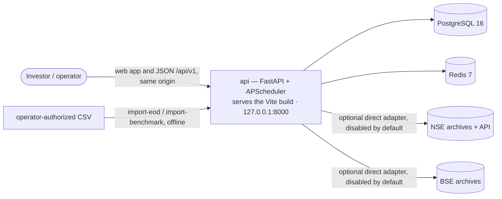

# Architecture — as built

Verified against the code on branch `wickstreet/m10-m11` (M10) on 2026-10-18. The host, enforcement and [Wickstreet 2.0 platform](#wickstreet-20-platform-slice-0) sections were verified on 2026-10-23 (Slice 0).

The approved blueprint is the [ADD](../architecture/ADD.md) and its [ADRs](../architecture/adr/). This page says what the code does today, and where it differs from that blueprint. When this page and the ADD disagree, the ADD still governs. The differences in [Drift from the ADD](#drift-from-the-add) need a decision.

## System

Docker Compose runs `db`, `redis` and `api`, and the one-shot `wickstreet-migrate` step before `api` starts. One image (root `Dockerfile`) builds the web app with Node and serves it from the API at `/`, so the browser calls `/api/v1` on the same origin (ADR-013). Every published port binds to `127.0.0.1`; the app has no authentication and is intended for one local user. `APP_BIND` can expose it to a network, but that instance is not secure without an authenticating proxy (ADR-012). `make up-dev` adds Adminer (8080) and RedisInsight (5540). The `api` container runs Momentum25 migrations on start, then `python -m apphost`, which serves Momentum25 at `/` and Wickstreet 2.0 at `/api/v1/mf` from one process. That process serves HTTP and runs the scheduler (ADR-007).

## Layers

Hexagonal architecture (ADR-001). Code lives in `backend/src/momentum25/`.

| Layer | Package | What it holds |
|---|---|---|
| Domain | `domain/` | Entities, value objects, ports, the 8 evaluation engines, pattern detectors, strategy engine, scoring, ranking, explainability, walk-forward backtest math (`backtest/`), Elliott Wave and chart-pattern analytics (`analytics/`), research math (`research/`: forward returns, data quality, stop-loss, swing targets, survivorship). No I/O. |
| Application | `application/` | Use cases (`use_cases/`, `use_cases/research/`), DTOs, two shared services (`services/corporate_actions.py`, `services/rs_ratings.py`). |
| Infrastructure | `infrastructure/` | SQLAlchemy models and repositories, Alembic migrations, NSE/BSE/Kite providers, NSE trading calendar, indicator and RS pipelines (pandas/numpy), Redis cache/lock/refresh gate, APScheduler, settings, structlog, Prometheus metrics, tracing, retry/circuit breaker. |
| Interface | `interface/` | FastAPI routers (15), dependency wiring, error handlers, middleware (including the `Host`/`Origin` guard), web-app serving (`api/spa.py`), input validation, Typer CLI, walk-forward wiring shared by CLI and API. |
| Composition | `main.py`, `app/services/` | App factory, startup/shutdown, daily job. `app/services/` holds the screening job and a bulk market-sync service. |

### Enforcement

`lint-imports` checks nine contracts in `backend/pyproject.toml`. CI runs it in the backend lint job.

1. Momentum25 layers: `interface` → `application` → `domain`.
2. Momentum25 `domain` imports nothing from `application`, `infrastructure` or `interface`.
3. Momentum25 `application` imports nothing from `infrastructure` or `interface`.
4. `momentum25` and `wickstreet` never import each other (ADR-023 OM-11).
5. `platform_common` imports neither application (U2).
6. Nothing imports `apphost` (U1).
7. Every `wickstreet` context is layered `interface` → `application` → `domain` (OM-11).
8. `wickstreet` domain and application code import no infrastructure, interface, wiring or persistence.
9. `wickstreet` domain and application code never import `wickstreet.config`, where the mode lives (OM-1).

All nine pass (2026-10-23). The Momentum25 contracts do not cover `infrastructure` or `app`.

## Wickstreet 2.0 platform (Slice 0)

Implements the platform items of [ADR-023](../architecture/adr/ADR-023-operating-modes.md) §7 (U1–U3, U6, U8). No MF data, analytics, agent or UI exists yet.

| Package | Holds |
|---|---|
| `platform_common/` | Code both apps use: structured logging (`log.py`), the async engine and unit of work (`database.py`), and the request-context, security-header, body-size and Host/Origin middleware with RFC-7807 problem responses (`http.py`). It imports neither app. Momentum25 imports it through its old module paths, binding its own error namespace, `M25_ALLOWED_HOSTS` and Prometheus metrics, so its behaviour is unchanged. |
| `wickstreet/` | The MF app. `app.py` is the composition root and the only reader of `WICKSTREET_MODE`. `config.py` holds the settings and the loopback rule. `context.py` holds `TenantContext` (tenant and user UUIDs). `dependencies.py` resolves a request's context and opens its tenant-scoped unit of work. `persistence/` holds the schema, roles, unit of work and the MF Alembic environment. `identity/` is the first bounded context, layered `domain` / `application` / `infrastructure` / `interface`. `cli.py` is the `wickstreet` command. |
| `apphost/` | The host. `main.py` mounts the MF app at `/api/v1/mf`, then Momentum25 at `/`, and enters both lifespans (Starlette runs none for a mounted app). `__main__.py` starts uvicorn on the configured address. |

**Modes.** `personal` uses the local identity adapter: one fixed tenant and user (UUIDv5 constants), registered at startup. `saas` refuses to start until the OIDC identity adapter exists (Phase 2). Personal mode refuses a non-loopback bind outside a container. Under Compose it binds `0.0.0.0` inside the container and refuses to start unless `WICKSTREET_PUBLISHED_BIND` (Compose passes `APP_BIND`) is loopback. The MF Host/Origin guard stays on.

**Tenancy.** MF tables live in the `wickstreet` schema. `wickstreet_owner` owns it and runs only the MF migrations. `wickstreet_app` is the runtime login: no superuser, no BYPASSRLS, DML grants on MF tables only. The app refuses to start as a superuser, a BYPASSRLS role or an MF table owner. Each request runs in one transaction that first sets `wickstreet.tenant_id` with `set_config(…, true)`. Every tenant-scoped table has forced row-level security, with one policy comparing its tenant column to that setting; an unset setting matches no row. Repositories also filter by tenant. Tables: `tenant`, `app_user` (migration `0001_identity_tenancy`).

**Migrations.** `backend/alembic-wickstreet.ini` points at `src/wickstreet/persistence/migrations`. Its version table is `wickstreet.alembic_version`, and it compares only the `wickstreet` schema. Setup is two steps, both outside API startup: `wickstreet db-roles` (with `WICKSTREET_ADMIN_DATABASE_URL`, a login that can create roles) creates or updates the roles and schema; `alembic -c alembic-wickstreet.ini upgrade head` runs as the owner. Compose runs both in `wickstreet-migrate`; locally, `make mf-migrate`.

| Criterion | Proven by (`backend/tests/wickstreet/`) |
|---|---|
| OM-1 no mode in domain or application | contract 9; `test_boundaries.py` scans those modules for mode names and values |
| OM-2 loopback only | `test_loopback_only.py`: bind rule, Compose published port, launcher, Host guard |
| OM-8 cross-tenant denial | `test_tenant_isolation.py`: per table in `tenant_cases.py`, as `wickstreet_app`: scan, read, change, delete, move, forge, no tenant, setting lifetime; no grants on Momentum25 tables; API `/me` |
| OM-10 no single-user tables | `test_schema_rules.py`: catalog rule for every MF table, and a probe table that breaks it |
| OM-11 boundaries | contracts 4–8; `test_boundaries.py` requires each context in contract 7 |
| OM-12 MF routes and migrations | `test_boundaries.py` (routes, metadata, `ALL_VERSIONED`); `test_schema_rules.py` (models match migrations; down and up leaves Momentum25's tables and version rows unchanged); `test_host.py` |

## Data stores

**PostgreSQL** (ADR-004). 28 tables, 21 Alembic migrations (`0001` → `0021`). `alembic check` still reports drift between the ORM and the migrations (R3-B-15).

| Group | Tables |
|---|---|
| Instruments | `securities`, `bse_scrip_junction` |
| Prices | `ohlcv_daily` (current provider, 2019-09-30 →), `legacy_ohlcv_daily` (NSE archive, 1994-11-03 →, overlaps the current provider to 2024), `bse_legacy_ohlcv_daily` (BSE archive, 2006-03-01 → 2024-01-01), `benchmark_index_daily` |
| Corporate actions | `corporate_actions`, `corporate_action_inference_log` |
| Universe and survivorship | `historical_universe`, `survivorship_gap_event`, `universe_membership` |
| Strategy and runs | `strategies` (`kind`: production, research or user), `screening_runs`, `screening_results`, `rule_results` |
| Strategy Studio (ADR-014) | `strategy_families` (append-only), `strategy_evaluations` (the research namespace; a completed row is final), `data_manifests` |
| History (ADR-014 §7) | `<table>_history` for `securities`, `ohlcv_daily`, `corporate_actions`, `benchmark_index_daily`, `historical_universe`; one sequence `data_revision_seq`; a `provenance` column on each versioned table |
| Validation | `forward_returns` |
| User | `watchlist_items`, `user_documents` (saved workspace and drawings, versioned by `revision`; ADR-013 §5), `alerts` |

Run tables are append-only per `run_id` (ADR-006). Triggers enforce the history tables, the append-only families and the final evaluations.

**Redis.** Universe RS-rating cache, a distributed lock, and a refresh cooldown gate. The API falls back to no cooldown when Redis is down.

**Strategy configs** are JSON files in [`docs/architecture/strategies/`](../architecture/strategies/). The API reads them at startup (`M25_STRATEGY_DIR`, default `../docs/architecture/strategies`) and syncs them into `strategies`. Do not move that folder without changing the setting.

## External data

| Source | Adapter | Use |
|---|---|---|
| NSE EOD bhavcopy (current) | `providers/bhavcopy.py`, `providers/nse_client.py` | Optional direct adapter, explicitly disabled by default; requires operator authorization. |
| NSE legacy archive | research backfill use cases | Prices 1994-11-03 → 2019-09-29 |
| BSE bhavcopy | `providers/bse_bhavcopy.py` | Optional direct adapter, explicitly disabled by default; requires operator authorization. |
| Authorized CSV exports | `momentum25 import-eod`, `momentum25 import-benchmark` | Supported offline daily-bar, corporate-action and benchmark imports. |
| NSE corporate actions API | `application/services/corporate_actions.py` | Optional direct refresh when explicitly enabled. The public data workflow accepts action CSVs. |
| Zerodha Kite Connect | `providers/kite.py` | Adapter exists. Nothing calls it. |

## Configuration

All settings come from `M25_*` environment variables (`infrastructure/config/settings.py`). Key ones: `M25_DATABASE_URL`, `M25_REDIS_URL`, `M25_DIRECT_EXCHANGE_DOWNLOADS_ENABLED` (default `false`), `M25_SCHEDULER_ENABLED` (default `false`; `.env.example` also sets `false`), `M25_SCHEDULE_CRON` (default `30 18 * * 1-5`, Asia/Kolkata), `M25_STRATEGY_DIR`, `M25_ALLOWED_HOSTS` (host names the API answers to; default loopback), `M25_WEB_DIST_DIR` (built web app to serve; empty = API only). See [operations/deployment.md](../operations/deployment.md).

## Drift from the ADD

The ADD was written for a greenfield MVP (milestones M0–M8). The code has grown past it. These items differ from the approved blueprint. Each needs either an ADD amendment or a code change. None is decided yet.

| # | ADD / ADR says | Code does | Recommendation |
|---|---|---|---|
| D1 | Indicators are pure domain functions (ADD §10, §17). | Indicator math runs in `infrastructure/pipelines/indicator_pipeline.py` with pandas and reads the database. `domain/indicators/` holds only the port. | Amend the ADD to accept the pipeline as an adapter, or move the math into the domain. The second keeps the "pure core" claim true. |
| D2 | Out of scope: backtesting, BSE, advanced patterns (ADD §4). | Walk-forward backtest, BSE legacy data, cup-with-handle and ascending-base detectors all ship. | Amend ADD §4–§6 and §27 to record them. |
| D3 | Not in the ADD at all. | Elliott Wave analysis, chart-pattern analysis, validation and research APIs, watchlist, market context. | Amend the ADD. They are isolated research surfaces (see [design.md](design.md#research-isolation)). |
| D4 | Redis is a later SaaS step (ADD §24, ADR-007). | Redis is a required service for caching, locking and the refresh gate. | Amend ADR-007 or write a new ADR. |
| D5 | Gate engines count in the momentum score (ADD §21). | `ScoringEngineImpl` drops gate engines from both weighted scores. Rank-neutral for the production strategy only, because the Trend Template scores 1.0 for every qualifier (IMPLEMENTATION_SPEC §10). | Amend ADD §21. |
| D6 | API: `GET /rankings/latest`, `GET /rankings/{run_id}` (ADD §14). | `GET /rankings/runs/{run_id}`; the latest run comes from `GET /runs/latest`. | Amend ADD §14 and IMPLEMENTATION_SPEC §5. |
| D7 | CLI commands `ingest` and `screen` (ADD §10). | `ingest` exits nonzero with the offline `import-eod` replacement; `screen` runs over stored data without downloads. | Resolved in release hardening. |
| D8 | Layers: domain, application, infrastructure, interface. | `app/services/` sits outside all four and no contract covers it. | Move it into `application` or `interface`, and add a contract. |
| D9 | Import contracts run in CI (README claimed this). | CI runs ruff, mypy, pytest, `npm run lint`, `npm run build`. Not `lint-imports`. | Add `lint-imports` to `.github/workflows/ci.yml`. |
| D10 | `POST /runs` triggers a refresh (ADD §16). | `POST /runs` schedules the offline-by-default ingest-and-screen pipeline; direct downloads require explicit opt-in. | Resolved in the 2026-10-19 E2E audit. |

The Wickstreet program ([ADD Amendment A1](../architecture/ADD-amendment-A1.md), ADR-011 to ADR-014) began on 2026-10-17. See [state.md](state.md#in-flight).
