# Design — how the system decides

Verified against the code at commit `f492f81` on 2026-10-18. Formulas and contracts: [IMPLEMENTATION_SPEC](../architecture/IMPLEMENTATION_SPEC.md) §8–§10. Where the code differs from the spec, this page says so.

Momentum25 has two independent ranking methods:

1. **Daily screener** — Minervini-style gates and weighted engines. Produces the Top 25. This is the product.
2. **Walk-forward backtest** — 3/6/12-month blended momentum with monthly rebalance. A research tool with its own brief. It does not use the screener's engines.

## 1. Daily screening pipeline

```mermaid
flowchart LR
  ingest["Ingest EOD bars"] --> adjust["Adjust for splits/bonuses"]
  adjust --> universe["Universe gates"]
  universe --> ind["Indicators"]
  ind --> rs["RS rating across universe"]
  rs --> eng["8 engines → RuleResults"]
  eng --> score["Momentum + Buy Setup scores"]
  score --> rank["Rank → Top 25"]
  rank --> persist["Immutable snapshot"]
  persist --> fwd["Forward returns (when mature)"]
```



| Step | Design |
|---|---|
| Ingest | Every EQ-series symbol on the latest session. No index cap. |
| Adjust | Splits and bonuses set a backward `adj_factor` per bar. Cash dividends are stored but do not adjust price. NSE data starts at 2011-01-06 for corporate actions; earlier bars are unadjusted and disclosed. |
| Universe | Mutual-fund and ETF units are excluded by ISIN (`INF…`, `domain/value_objects/instrument.py`). Then the strategy's `universe` block: min price ₹20, min average turnover ₹1 crore, min 252 sessions of history, series `EQ`. Each security's admission reason goes to `universe_membership`. |
| Indicators | SMA 50/150/200, EMA 10/21, RSI 14, ATR 14, ADR% 20, 52-week high/low, SMA200 slope (22 sessions), average volume 50, relative volume, RS-line slope (50). Insufficient history gives `None` and the stock is ineligible. |
| RS rating | Weighted return over 63/126/189/252 sessions (0.4/0.2/0.2/0.2), then percentile across the run's universe (1–99). |
| Engines | See §2. |
| Scores and rank | See §3. |
| Persist | `screening_runs` + `screening_results` + `rule_results`, keyed by `run_id`. |
| Forward returns | Horizons 5, 10, 20, 60, 120 and 252 sessions, benchmark-relative to NIFTY 500. Appended once mature, never revised. |

Run states: `PENDING` → `RUNNING` → `COMPLETED` or `FAILED`. A failed run exposes no partial snapshot.

Triggers: the scheduler (weekdays 18:30 IST when `M25_SCHEDULER_ENABLED=true`) and `POST /runs/execute`.

Single-stock live analysis (`GET /stocks/{symbol}/live`) runs the same strategy engine on one symbol. A Redis refresh gate limits how often it re-fetches from NSE (`M25_LIVE_REFRESH_COOLDOWN_SECONDS`).

## 2. Strategy, engines and rules

A strategy is a versioned JSON file (ADR-005). It sets the universe, indicator windows, enabled engines, rules, parameters, weights, gates and tie-breakers. `config_hash` is part of run identity.

**Production strategy:** [`minervini_trend_template.json`](../architecture/strategies/minervini_trend_template.json), version 3.

| Engine | Gate | Weight (momentum / buy setup) | Rules in v3 |
|---|---|---|---|
| `trend_template` | **yes** (engine) | 3.0 / 1.0 | `tt_close_above_sma150_200`, `tt_sma150_above_sma200`, `tt_sma200_uptrend`, `tt_sma_stack`, `tt_close_above_sma50`, `tt_above_52w_low` (≥30%), `tt_near_52w_high` (≤25% below), `tt_rs_rating_min` (≥70) |
| `relative_strength` | no | 2.0 / 1.0 | `rs_rating` (normalized 70–99) |
| `volume_accumulation` | rule `vol_liquidity_min` is a gate | 1.0 / 2.0 | `vol_liquidity_min` (≥₹1 crore turnover), `vol_accumulation_days` (25), `vol_breakout_confirm` (rel. volume ≥1.4) |
| `pattern` | no | 1.0 / 1.5 | One rule per registered detector: VCP, flat base, ascending base, cup with handle |
| `breakout` | no | 1.5 / 3.0 | `bo_pivot_breakout`, `bo_followthrough`, `bo_false_breakout` |
| `momentum_quality` | no | 1.0 / — | `mq_trend_persistence`, `mq_acceleration` |
| `risk` | no | 0.5 / 1.5 | `risk_extension` (≤25% above SMA50), `risk_atr` (ADR ≤8%), `risk_rr` (risk ≤16%) |
| `fundamental` | — | disabled | Port only. No data source. |

v3 removed `rs_sector_relative`, `rs_industry_relative` and `rs_line_uptrend`. They passed 0% of 90,657 evaluations, and sector data does not exist. The code still registers them. The v3 description names a high-tight-flag detector; no such detector exists.

Other strategies in the same folder are research variants (`kind: research`): `benchmark_a_pure_momentum`, `benchmark_b_rs_only`, `benchmark_c_trend_template_only`, `benchmark_d_equal_weight`, `benchmark_e_moving_average_trend`, `experimental_rs80`.

## 3. Scoring and ranking

Implemented in `domain/scoring/` with `Decimal` only.

```
engine_score     = Σ rule.contribution (sorted by rule_id) / Σ rule.weight
momentum_score   = 100 · Σ(w_e · engine_score) / Σ w_e      over non-gate engines
buy_setup_score  = 100 · Σ(s_e · engine_score) / Σ s_e      over non-gate engines
hard_filters_passed = every gate engine and gate rule passed
```

- **Gates.** A stock that fails a gate is still scored and explained, but gets `rank = None`. It is not in the qualified set.
- **Gate engines are left out of the weighted scores.** Among qualifiers a gate engine scores 1.0 by construction, so it adds only a constant. The ADD §21 formula includes it. The ranking is the same either way.
- **Ranking.** Sort qualifiers by `momentum_score` descending, then `buy_setup_score`, then `rs_rating`, then `symbol`. Top 25 = rank ≤ 25.
- **Precision.** Prices 0.01, scores 0.0001, percentages 0.01 (ADR-009).

## 4. Explainability

Every `RuleResult` stores pass/fail, raw value, threshold, operator, weight, contribution and an explanation string. These rows are persisted per run, so a past explanation never changes. `GET /rankings/runs/{run_id}/stocks/{security_id}/explanation` and `GET /stocks/{symbol}` return them. No score leaves the API without its rule results (NFR-3).

Return-derived metrics carry a `measurability` block. With no matured forward return the metric is `null` and the block says why. An unmeasured metric is never reported as zero.

## 5. Determinism

ADR-009 is the contract. In practice:

- `Decimal` at every persisted boundary. Indicator math uses numpy floats, then quantizes.
- Rule contributions reduce in sorted `rule_id` order.
- The domain reads no clock and no random source. `Clock` is a port.
- Run identity = strategy + `data_version` + `config_hash`.
- `POST /research/verify/determinism` recomputes a run and compares it byte for byte.

## 6. Walk-forward backtest

Ground truth: [backtest brief](../history/backtest-loop/brief.md) (status FINAL, 2026-08-17) and its three addenda. Code: `domain/backtest/` (math), `application/use_cases/walk_forward.py` (runner), `interface/walk_forward_wiring.py` (shared by CLI and API).

| Item | Rule |
|---|---|
| Universe | Intended: Nifty 500 constituents at each rebalance, ≥12 months of history, no T2T/ASM stocks. |
| Score | `(r3m + r6m + r12m) / 3` on adjusted close. No skip-month. |
| Selection | Top 30, equal weight. Tie-break 12M, then 6M, then 3M return. |
| Rebalance | Monthly. Decide at the close of the last session of month M-1. Brief: fill at the open of the first session of month M. **Code fills at that session's adjusted close** (`ohlcv_daily.adj_close`), because the price provider loads only `adj_close`. See [state.md](state.md#open-defects). |
| Buffer | Hold while rank ≤ 45 (1.5 × 30). Add only from the top 30. |
| Costs | 30 bps flat on traded notional, every buy and sell. |
| Benchmark | Brief asks for Nifty 500 TRI. Only the price index exists, so every result carries the label "Nifty 500 Price Index (not TRI)". |
| Look-ahead | The runner rejects any price dated on or after the decision date (`LookAheadError`). Providers enforce it too. |

Accepted approximations: delisting-date survivorship is real (`securities.delisting_date`, `last_trade_date`). Point-in-time Nifty 500 membership and T2T/ASM history have no free source, so that eligibility check is a labelled stub. Every result carries a `survivorship_warning`, and the backtest page shows it.

## 7. Research isolation

Elliott Wave, chart-pattern annotations, swing targets and the analysis page's target and risk-reward figures are research surfaces. None of them feeds the momentum score, the ranking, the gates or the stop-loss.

The suggested stop-loss is risk-only: `entry − k · ATR(14)`, falling back to the last confirmed swing low, plus a chandelier trailing variant. It carries no target, R-multiple or reward figure.

On 2026-08-10 the user removed the earlier "no Buy/Sell signal" constraint for the analysis screen. Its signal score runs in the browser (`web/src/lib/strategies.ts`) and is never stored. Making signals a scoring input is an open proposal: [signal-engine proposal](../history/plans/2026-08-10-signal-engine-proposal.md).
