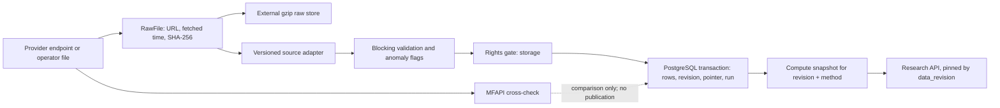

# Wickstreet MF data architecture — as built

**Verified against the repository on 2026-10-24.** This is the implementation reference for the Wickstreet 2.0 mutual-fund data path. The existing [architecture page](architecture.md) describes the larger application; the [metric method](mf-metrics.md) remains the authority for calculation definitions. Source procedures are in [MF source runbooks](../operations/mf-source-runbooks.md), and disaster recovery is in [MF data recovery](../operations/mf-data-recovery.md).

The implementation is under `backend/src/wickstreet/`. It is a local PostgreSQL pipeline, not a hosted data service. The live app reads immutable analytics snapshots; acquisition commands and the in-process daily job publish new source revisions.

## Source catalogue

All endpoints and observed file layouts below are the endpoints the adapters call or parse. They are not commitments by the providers to keep those endpoints or formats stable. Observed coverage and cadence are not guarantees.

| Source | Data and URL / endpoint | Format and coverage | Refresh and access |
|---|---|---|---|
| AMFI direct | [NAV history](https://portal.amfiindia.com/DownloadNAVHistoryReport_Po.aspx) with `frmdt=DD-Mon-YYYY&todt=DD-Mon-YYYY`; [scheme master](https://portal.amfiindia.com/DownloadSchemeData_Po.aspx?mf=0) | One UTF-8 semicolon NAV file per requested date; UTF-8 CSV scheme master. NAV endpoint's first served date is discovered by the backfill (observed 2023-04-01); master is the current full plan-option listing. | Daily NAV/master refresh at 11:30 IST; public endpoint, no login/API key in code. `amfi.py`. |
| AMFI facts | [Scheme list](https://www.amfiindia.com/api/populate-scheme?MF_ID=1); [SSD XML](https://portal.amfiindia.com/spages/SSD_1.xml); [TER workbook](https://www.amfiindia.com/api/populate-te-rdata-revised); performance gateway `https://www.amfiindia.com/gateway/pollingsebi/api/amfi/`; [tracking error](https://www.amfiindia.com/api/tracking-error-data); [IDCW](https://www.amfiindia.com/api/scheme-dividend); [market-cap listing](https://www.amfiindia.com/otherdata/categorisation-of-stocks) | JSON lists/reports and a combined retained JSON file; one XML per scheme; monthly XLSX for TER; XLS/XLSX half-yearly market-cap list. Performance reports are observed from 2019 onward; earlier coverage varies by report. SSD and IDCW are fetched for schemes with NAVs in the preceding 30 days. | Operator-run. Scheme list queries fund-house IDs 1–120; each SSD/IDCW query is per eligible scheme; TER is one request per month; performance and tracking error are requested on stored NAV dates; market caps are June 30 and December 31. Public endpoints, no credentials in code. `amfi_facts.py`. |
| TigZig | [Full AMFI NAV archive](https://api.tigzig.com/mf/v1/download/amfi_nav_master.csv.gz); [latest scheme snapshot](https://api.tigzig.com/mf/v1/download/amfi_nav_master_latest.csv.gz) | Gzipped UTF-8 CSV. Archive columns: `scheme_code,date,nav,scheme_name,isin,source`; MF rows from 2006-04-01 are reported by the publisher. Snapshot is a compressed CSV. Archive NAV precision is four decimals. | Downloaded for `mf archive`; no API key in code. The adapter downloads the complete archive, filters the requested range locally and stages month files outside the repository. `tigzig.py`. |
| MFAPI | `GET https://api.mfapi.in/mf/{amfi_code}` | JSON `meta`, `data[{date: DD-MM-YYYY, nav: string}]`, `status`. Provider describes historical NAV data; actual date coverage varies by scheme. | `mf crosscheck` only; no reference values are published into MF tables. One sequential request per sampled scheme, default sample 50. No credentials in code. `mfapi.py`. |
| AMCs | PPFAS, DSP, Nippon India, SBI, ICICI Prudential, Tata, Motilal Oswal, UTI and Baroda BNP Paribas; URLs and their listing/download mechanisms are in the AMC runbook below. | Monthly XLS/XLSX workbooks or ZIPs of workbooks. Layouts are AMC-specific but normalized by one parser. `portfolios.py` and `amc.py`. | Operator-run for an as-of month. HTTP retrieval is implemented for these nine providers. Any other supported workbook can be imported by hand. No login is configured. |
| RBI | [DBIE](https://data.rbi.org.in/DBIE/) and RBI publications/releases | Manual XLSX from the Handbook of Statistics on the Indian Economy or HTML for “Treasury Bills: Full Auction Result”. The stored series is the 91-day T-bill implicit yield at cut-off price. | Human download only; Wickstreet has no RBI fetcher. Handbook is annual; auction releases are weekly when published. `rbi.py`. |
| Local CAS import | User-selected CAMS, KFintech, NSDL or CDSL statement through `wickstreet.portfolio.infrastructure.cas` | Parsed locally into the tenant-owned portfolio ledger. The original CAS file and password are not retained; the database stores a file hash and normalized transactions. | User action only. This is personal portfolio input, not a reference-data provider. Never put real CAS files or details into Git, fixtures, docs or logs. |

### Sources outside this ingestion graph

There is no MFAPI or TigZig data dependency in analytics. MFAPI is a diagnostic cross-check. NSE/BSE index TRI and ETF trade data are not acquired; benchmark analytics use a labelled index-fund/ETF proxy as specified in [MF metrics](mf-metrics.md). Momentum25 stock feeds and tables are separate and are not Wickstreet MF inputs. There is no broker integration supplying MF reference data, no RBI GDP/FX series, and no automated CAS retrieval.

## Provider terms and owner decisions

The columns are deliberately separate: the database rights register is Wickstreet's owner decision and a runtime gate; it is not an upstream licence or provider permission.

| Provider | Source terms / status checked 2026-10-24 | Owner decision in this repository | Provider permission actually evidenced here |
|---|---|---|---|
| AMFI | [AMFI Terms of Use](https://www.amfiindia.com/terms-of-use) allow personal, non-commercial access, prohibit electronic storage of a “significant portion”, and require written agreement for other use. Terms can change. | [ADR-023 U10/U14](../architecture/adr/ADR-023-operating-modes.md#7-architecture-review-update-2026-10-23) records personal-mode bulk acquisition and added facts datasets as the owner's direction and acceptance of risk. The instance `rights_grant` rows gate each use. | No AMFI written permission is recorded in the repository. Owner authorisation is not AMFI permission. SaaS/commercial mode has no data grant and is not implemented. |
| TigZig | Publisher says the archive is sourced from AMFI; its published material requests attribution to the source URL and author and gives no warranty. See [API documentation](https://blog.tigzig.com/apis/mf-nav). | ADR-023 U11 directs its use before AMFI's first served date and as a fill-only source after that date. | No AMFI, TigZig or upstream data licence is evidenced here. The direction is the owner's choice, not permission from either provider. |
| MFAPI | [Homepage](https://www.mfapi.in/) describes an open, unauthenticated JSON API; [API docs](https://www.mfapi.in/docs/) mention fair-use rate limiting and caching but no numeric limit. The site's terms link was not available for review during this check. | ADR-023 U11 authorizes only a local personal-mode cross-check. | No data-storage or republication permission is evidenced here. The runtime grant for storing the cross-check response is an owner decision. |
| AMC disclosures | Per-AMC web terms are not a blanket permission. See [ADR-023 U14](../architecture/adr/ADR-023-operating-modes.md#7-architecture-review-update-2026-10-23): the owner records each source basis; Baroda BNP Paribas terms were noted as barring copying without written consent. Automated grants do not cover ABSL or AMCs whose sites block automation. | U14 records the owner's decision to use the supported AMC disclosures in personal mode, with source-specific rows in `rights_grant`. | No blanket provider permission is evidenced in this repository. The owner recorded decisions/risk acceptance; that is not a grant from an AMC. |
| RBI | The historic DBIE disclaimer cited in [data-source research](../plans/wickstreet-2/12-d0r-data-source-research.md) allowed reproduction with acknowledgement. The current DBIE disclaimer could not be verified in the site during this check; inspect it before relying on the historic wording. | The app imports manually selected files and requires an owner storage grant. The RBI series and endpoint do not run automatically. | No signed permission is recorded. Manual public download plus an app grant must not be represented as a separate RBI licence. |

The active per-instance record is inspected with `wickstreet rights list`. It is not committed because the register is deployment data. `basis`, `mode`, and `use` should describe the owner's decision precisely; do not copy credentials into that text.

## Source-specific adapters

The implementation and its fixture tests are the parser specifications. The source runbook lists file-level quirks and supported fallback imports. Strict or heuristic parsing is intentional: unknown layouts fail or produce unmatched counts rather than silently being interpreted as facts.

| Adapter | Implementation rules and significant quirks | Parser/recovery tests |
|---|---|---|
| AMFI NAV/master | NAV header is exact; rows have eight semicolon fields beneath category and AMC section labels. Dates use fixed English month abbreviations. `222.` is a valid NAV. Master is CSV with an exact header; two adjacent ISINs are extracted from the final column. | `tests/wickstreet/test_amfi_adapter.py`; raw reparse in `test_mf_ingestion.py`. |
| TigZig archive | Header must match exactly; validates gzip/UTF-8/CSV and ISO dates, skips rows whose `source` is not `MF` (including SIF), filters the requested interval, preserves month order and imports four-decimal values. Latest snapshot lacks launch/closure/minimum fields; it fills only missing master codes. | `test_archive_sources.py`, `test_mf_ingestion.py`. |
| MFAPI | Requires JSON `status == SUCCESS`; parses `DD-MM-YYYY`; malformed/non-numeric NAV is retained as missing for comparison. Comparison tolerance is `0.0001`; two missing values compare equal. | `test_archive_sources.py`, `test_mf_ingestion.py`. |
| AMFI facts | SSD XML accepts `SchemeSummary` elements and label/value `<records>` layouts; text is compacted and known “not filed” values omitted. TER XLSX uses the first sheet, exact header anchors, Excel serial dates and change points. Scheme, performance, tracking-error, IDCW and caps use named JSON/XML/XLSX layouts. Fact rows join by source code/name, or performance by the regular/direct NAV pair; unjoined items are counted, never guessed. | `test_mf_facts.py`, `test_mf_ingestion.py`. |
| AMC holdings | XLS/XLSX magic bytes are detected; ZIP may contain a workbook or several. Parser searches the first 60 rows for an ISIN and `% to net assets` header, reads scheme/date above it, skips totals/subtotals and stops at grand total. It detects percentage vs fraction weights, section totals in some ICICI sheets, derivatives by line/industry/contract month, Tata's negative-quantity futures, lettered sections, IRS section and `Net Assets` end marker, UTI scheme blocks and duplicate scheme/date portfolios. Scheme joins are normalized name matches. | `test_mf_holdings.py`, `test_mf_ingestion.py` cover synthetic workbook/parser behavior. They do not fixture live AMC listing pages; in particular, current Tata and Motilal Oswal listing additions have no provider-listing fixture test. |
| RBI | XLSX first sheet finds date and “Implicit Yield at Cut-off Price”; accepts Excel serials or `DD-Mon-YYYY` text. HTML parser locates the 91-day column at the cut-off row; weeks without accepted bids yield no rate. Rates are quantized to four decimals and validated in `(0, 25]`. | `test_mf_rates.py`. |

## PostgreSQL data model and identity

Wickstreet migrations own PostgreSQL schema `wickstreet`, with their own `wickstreet.alembic_version` and Alembic environment (`backend/alembic-wickstreet.ini`). Migration order is `0001_identity_tenancy` → `0002_mf_data_foundation` → `0003_mf_analytics` → `0004_reference_rates` → `0005_research_records` → `0006_scheme_facts` → `0007_holdings` → `0008_portfolio_ledger` → `0009_distributions` → `0010_snapshot_retirement`. The Momentum25 migrations do not own these tables.

| Table(s) | Key / relation | Purpose |
|---|---|---|
| `rights_grant` | source × mode × use (one active row per key) | Owner's auditable use decision; runtime role reads, owner login writes. |
| `ingestion_run` | source × dataset × period | Durable checkpoint, status, attempts, counts, errors and conflicts. A run may have multiple revisions over time. |
| `revision`, `publication` | revision → run; `publication.id = 1` points to current revision | URL, fetch time, raw SHA-256/path, adapter version, contract, retrieval/storage grant IDs; one global current pointer. |
| `plan_option` | unique AMFI code; generated internal integer ID | A NAV series for one plan-option. AMFI code is the source identity; internal ID is the foreign-key identity. |
| `nav` | plan-option × NAV date × revision | As-filed decimal NAV, anomaly, and revision visibility. Changed values supersede prior rows; they are not overwritten. |
| `plan_option_listing`, `plan_option_master` | plan-option × effective date × revision | Effective-dated attributes from daily NAV files and the scheme master, respectively. |
| `scheme`, `scheme_isin`, `scheme_fact` | AMFI `SD_Id`; ISIN; scheme × fact × plan × as-of × revision | AMFI fund-house scheme identity, ISIN/code bridges from SSDs, and filed TER/performance/profile facts. |
| `holding`, `security_class` | scheme × disclosure date × line/revision; ISIN × date × revision | Monthly portfolio rows and half-yearly market-cap class. |
| `distribution`, `rate_point` | plan-option × record date; rate series × effective date × revision | IDCW distributions and reference rates such as 91-day T-bill yield. |
| `metric_snapshot` | data revision × method version | Immutable, compressed analytics payload, SHA-256, source/grant ids and as-of date. Retired snapshots remain for audit. |
| `plan_option_link` | from/to internal plan-option IDs + link kind | Owner-curated merger, code-change and segregated-portfolio links; never inferred. |
| `research_record`, `portfolio_import`, `portfolio_txn` | tenant/user scoped | User-owned saved research and normalized CAS transactions. Forced RLS; original CAS is not stored. |

**Identity matching.** AMFI scheme code identifies a plan-option and `SD_Id` identifies AMFI's scheme/fund-house record. SSD ISINs are the primary bridge from plan-option master rows to `scheme`; SSD phased-out AMFI codes are the secondary bridge. A normalized scheme-name match is allowed only when unique. SSD code/ISIN disagreement is resolved only where the plan-option name uniquely supports the code mapping. Performance joins by normalized name, then by a unique pair of regular/direct NAV values on that date. TER joins by SEBI scheme code then name; tracking error by scheme name. Unmatched rows are counted and reported. AMFI code changes/mergers are stored only as owner-curated `plan_option_link` evidence, not stitched by analytics.

## Processing and publication

1. **Acquire.** Checkpoint on `(source, dataset, period_start, period_end)`. A PostgreSQL advisory lock serializes ingestion. Retrieval grant is checked before a provider request; storage grant is checked before a publish.
2. **Keep raw.** Raw bytes are SHA-256 hashed and gzip-compressed outside Git at `<WICKSTREET_RAW_DIR>/<source>/<dataset>/<year>/<period>-<sha256-prefix>.gz`. Writes use a temporary `.partial` followed by atomic rename. Same payload/period is write-once. TigZig retains the downloaded full archive; its monthly staging CSVs are disposable.
3. **Validate and normalize.** Unknown file headers, impossible dates, empty blocking datasets, duplicate conflicting keys or invalid values fail the run. NAVs with missing/zero/negative values and moves above the configured 25% threshold are retained with flags. Joins do not guess. Parser version is recorded on every data revision.
4. **Publish atomically.** One PostgreSQL transaction inserts a revision, supersedes changed rows, inserts current rows and updates the single publication pointer. Readers see the old or new pointer, never a partial write. Visibility at revision `R` is `row.revision_id <= R` and `(superseded_revision IS NULL OR superseded_revision > R)`.
5. **Snapshot.** A successful CLI publish computes analytics for the new pointer unless that command has `--no-compute`; app refresh also computes/warm-loads a snapshot. Snapshot uniqueness is `(revision, method_version)` and rows are not updated. Any method change increments `METHOD_VERSION` (currently 8).
6. **Serve.** `/api/v1/mf` reads the snapshot at the requested `data_revision` or current snapshot. Responses carry data/latest revision, method version, as-of date and sources. The database reader uses repeatable-read for full history and streams NAVs by plan-option.

Research routes include `/funds`, `/funds/{code}`, `/funds/{code}/metrics`, `/funds/{code}/navs`, `/funds/{code}/profile`, `/funds/{code}/benchmark`, `/funds/{code}/holdings`, `/holdings/overlap`, `/risk-free`, `/screener/fields`, `/screener/run`, `/compare`, calculators, and historical/peer analytics. See `backend/src/wickstreet/analytics/interface/http.py` for the complete route contract.

## Reconciliation and coverage rules

- **NAV precedence:** the first date AMFI serves is detected per backfill. Before it, TigZig is source of record. From it onward, AMFI is source of record; TigZig may fill only missing code/date pairs. Archive disagreements never replace direct AMFI and increment run conflicts. Differences up to `0.0001` are treated as archive rounding.
- **Duplicate handling:** duplicate same-key/same-value records collapse; conflicting NAV records for the same code/day block publication. One current row per plan-option/day is enforced. Facts and portfolio lines have per-key current uniqueness. A second portfolio for one scheme/date is surfaced as unmatched instead of merged.
- **Corrections:** changed upstream data creates a new revision and marks replaced rows as superseded. Anomaly flags do not discard data. Adapter fixes use raw-file reparse where a command supports it. Existing metric snapshots are retained by revision/method; a correction yields a new snapshot.
- **Expected NAV window:** initial default is ten years plus a seven-day start margin through yesterday; the history accumulates and is not trimmed. The current upstream archive is wider (reported from 2006-04-01), but the normal command imports only the chosen start/end window. Current holdings/facts/caps are bounded by publisher availability and the manually requested dates.
- **Reports:** `mf report` checks NAV dates/gaps/anomalies, per-source NAV rows, master joins, run statuses, unavailable/failed periods and archive conflicts. It is not a full fact/holdings completeness report; inspect `ingestion_run` by source/dataset for those datasets.

## Operations, detection and reproducibility

- **Automatic:** with `WICKSTREET_REFRESH_ENABLED=true` (Compose default), the app's in-process APScheduler runs the AMFI master and NAV refresh daily at 11:30 Asia/Kolkata. At startup it catches up once if today's slot passed. It re-reads the last seven calendar days, or starts the day after the last stored NAV after a longer outage. Scheduler state is in memory; the database run row and ingestion lock are the durable checkpoint.
- **Operator cadence:** AMC portfolio files and facts are not scheduled. Fetch/import monthly after source publication; update AMFI half-yearly market caps after June/December files appear; import RBI weekly auction results (or annual handbook) when obtained; run `mf report` after acquisitions. The exact commands are in the runbook.
- **Retry:** adapters serialize requests with a 1-second minimum interval, 120-second default timeout (AMFI facts uses at least 180 seconds) and four attempts. Transport errors, HTTP 429 and 5xx retry with exponential waits; other 4xx/layout errors fail without retry. Failed runs remain visible and are retried by a later explicit command. Settled published/unchanged/unavailable periods skip unless the command offers `--refetch`.
- **Change detection:** raw SHA-256 detects same-period unchanged payloads; exact headers and required JSON/XML fields fail closed on layout changes; parsers version data revisions. There is no independent website-change monitor or alert service. Inspect command output and `mf report`; the process logs refresh and snapshot failures.
- **Determinism:** ingest numeric values use Python `Decimal`; dates and row order are explicit. Snapshot JSON has sorted keys and plan-option order, floats are rounded to 10 significant digits, gzip timestamp is fixed to zero, and SHA-256 is stored. Method v8 addresses cross-platform last-bit variation; repeat an actual compute on a supported OS before claiming byte parity at every rounding boundary.
- **Rebuild snapshots:** `wickstreet mf metrics` computes the currently published revision if missing. It is a no-op if `(revision, method version 8)` exists. To regenerate a retired or new-method snapshot, use the documented retirement/new-method workflow and preserve old method rows.
- **CAS privacy:** DB backups include tenant-owned normalized transaction rows, but not real CAS files/passwords. Keep DB backups private. Never commit raw CAS, raw MF source files, database URLs, or provider credentials.

### Reparse paths currently implemented

| Data | Parser-only route | Notes |
|---|---|---|
| AMFI NAV dates | `mf reparse [--start ... --end ...]` | Reads retained raw for published dates and verifies its SHA-256. |
| TER, fund performance, tracking error | `mf facts DATASET --start ... --end ... --reparse` | Replays saved period payloads. |
| AMC holdings | `mf portfolios --amc NAME --start ... --end ... --reparse` | Replays saved monthly file. |
| SSD, scheme list, IDCW, market caps, RBI | No universal parser-only command | Reacquisition/refetch or a changed manual source file is the current supported route. See limitations in the runbook; a same-hash refetch is an unchanged no-op. |
| TigZig archive | No offline parser-only CLI command | `mf archive --refetch` downloads the archive again and reparses it; the retained gzip can only be replayed using adapter-level tooling. |

When modifying a source adapter, update its runbook and this source catalogue, bump the adapter version, update its corresponding parser fixture test, and update/retest the relevant raw replay path. Metric or classification changes also update [mf-metrics.md](mf-metrics.md) and `METHOD_VERSION`.

## Recovery and verification

The coupled recovery set is (1) a PostgreSQL dump of the database, (2) the external raw directory, (3) the deployment's database-role secrets/settings from its secure store, and (4) this repository version. A dump alone restores published data but cannot replay missing raw files; raw files alone do not contain checkpoints/revision history and there is no generic directory-to-database importer. After complete DB loss, reacquire source data using the runbook order.

See [MF data recovery](../operations/mf-data-recovery.md) for the verified restore procedure. Verification on 2026-10-24 used an ephemeral Postgres 16 container without a volume: one synthetic NAV parser/reparse fixture passed; a custom-format DB dump restored into a new database; `mf report` succeeded on the restored DB; then `mf reparse` read the restored DB's retained raw file and returned `unchanged`. No production DB, real MF raw file, CAS statement, or secret was used. The check verified NAV restore/replay, not every live provider's availability or terms.
