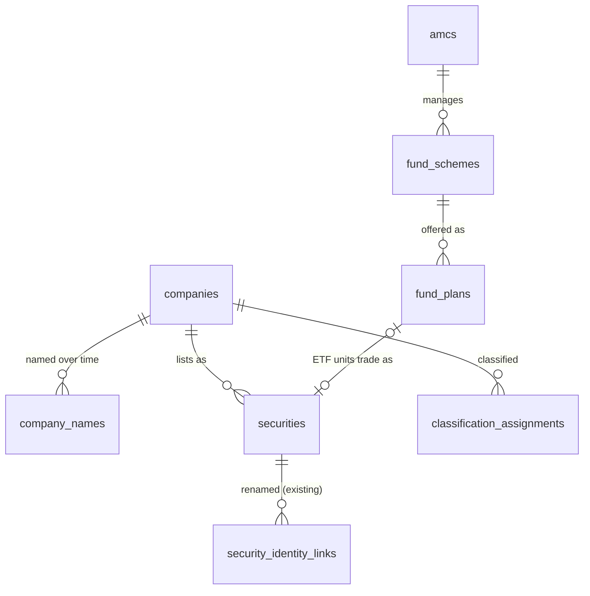

# 05 — Canonical Data Model and Architecture

> Part of the [Wickstreet 2.0 blueprint](README.md). Status: Proposed. Governing decisions: [ADD Amendment A2](../../../architecture/ADD-amendment-A2.md), ADR-016 to ADR-021.

## 1. Principles

1. **One process, one database.** No new services. FastAPI + APScheduler + PostgreSQL + Redis, as today (ADR-002, ADR-004, ADR-007).
2. **Two clocks on every fact.** *Business time* says when a fact is true (a quarter's end, a portfolio date, an effective date). *Knowledge time* says when the fact became public (`published_at`) and when we stored it (`revision_id`, `recorded_at`). Every point-in-time read filters on knowledge time.
3. **Append, never overwrite, source facts.** A restatement is a new filing. A corrected disclosure is a new disclosure that names the one it revises. The ADR-014 history tables catch only our own import corrections.
4. **Derived values are rebuildable.** Metrics, scores and screen snapshots are computed from source facts by versioned domain code. They are cached, never treated as truth.
5. **Three value states.** A metric is a number, `NM` (not meaningful: defined but misleading, e.g. PE on a loss), or `NA` (an input is missing). Each `NM`/`NA` carries a reason code. Nothing becomes zero by default.
6. **Provenance on every source row.** `recorded`, `published` or `reconstructed` (ADR-014 §7), plus `source` and `source_ref` (file hash, filing id or URL).
7. **Asset classes stay distinct.** Equity, ETF and mutual-fund plan are different instrument types with different fields. Shared code exists only where the finance is the same (returns from a price series, drawdown).

## 2. Layers and modules

New code follows the existing hexagonal layout. Package names below sit under `backend/src/momentum25/`.

| Layer | New module | Holds |
|---|---|---|
| Domain | `domain/fundamentals/` | Filing, statement and line-item value objects; the canonical line-item taxonomy; TTM and period arithmetic; `MetricEngine` with one pure function per metric; `MetricValue(value, state, reason, inputs)` |
| Domain | `domain/funds/` | Scheme, plan, NAV series, return and risk math (CAGR, rolling, drawdown, volatility, Sharpe, Sortino, capture ratios, tracking difference and error), SIP and lump-sum simulation, holdings exposure, overlap, effective holdings |
| Domain | `domain/screening/` | Field registry, filter AST, evaluator, sort, explanation of each row's pass/fail |
| Domain | `domain/portfolio/` | Transactions, lot ledger (FIFO), holdings derivation, valuation, XIRR, look-through, drift |
| Domain | `domain/scorecards/` | Dimension definitions and percentile scoring (ADR-020) |
| Domain | `domain/ports/` | `FundamentalsSource`, `FundSource`, `HoldingsSource`, `ClassificationSource`, `PortfolioRepository` (ports only) |
| Application | `application/use_cases/company.py`, `funds.py`, `screener.py`, `portfolio.py`, `imports/` | Orchestration, DTOs, import validation |
| Infrastructure | `infrastructure/persistence/` models + migrations `0026`… | New tables; `PointInTimeFundamentals`, `PointInTimeFunds` beside `point_in_time.py` |
| Infrastructure | `infrastructure/importers/` | One parser per accepted file format (AMFI NAV text, AMC portfolio spreadsheet, XBRL instance, normalized CSV, CAS CSV). No network code in the default build. |
| Interface | `interface/api/routers/companies.py`, `funds.py`, `screener.py`, `portfolio.py`; CLI `import-*` commands | HTTP and CLI |

`lint-imports` gains one contract: `domain.fundamentals`, `domain.funds`, `domain.screening`, `domain.portfolio` and `domain.scorecards` import nothing from `domain.engines` except through `domain.ports`. This keeps Momentum25 and the new engines independent.

## 3. Canonical data model

All new tables carry `tenant_id` (NULL, the ADR-010 seam). Tables marked **V** use the `Versioned` mixin and get a `<table>_history` table and the trigger. Amounts are stored in rupees as `numeric(20,2)`, never in crores. Display converts.

### 3.1 Identity



| Table | Key columns | Notes |
|---|---|---|
| `companies` **V** | `company_id`, `cin` (unique, nullable), `primary_isin_prefix`, `incorporated_on`, `entity_template` (`general`, `bank`, `nbfc`, `insurance`) | The issuer. `entity_template` picks the statement taxonomy. |
| `company_names` **V** | `company_id`, `name`, `valid_from`, `valid_to`, `source`, `source_ref` | Effective-dated names. Never inferred. |
| `securities` (existing) | + `company_id` FK, + `instrument_type` (`EQUITY`, `ETF`, `REIT`, `INVIT`, `OTHER`) | Additive columns. `instrument_type` defaults to `EQUITY`; the Phase 3 migration sets `ETF` from the ISIN and the scheme master (`INF…` ISINs). |
| `classification_schemes` | `scheme_code` (`NSE_IC_2023`, `AMFI_MCAP`, `SEBI_MF_2017`), `levels`, `source`, `licence_note` | Which taxonomy. |
| `classification_assignments` **V** | `subject_type` (`company`, `security`, `fund_scheme`), `subject_id`, `scheme_code`, `level`, `value`, `valid_from`, `valid_to`, `published_at` | Sector, industry, market-cap bucket and SEBI fund category, all effective-dated. One table for all of them. |
| `amcs` **V** | `amc_id`, `name`, `sebi_registration` | |
| `fund_schemes` **V** | `scheme_id`, `amc_id`, `name`, `asset_class` (`equity`, `debt`, `hybrid`, `solution`, `other`), `structure` (`open`, `close`, `interval`), `is_index_fund`, `is_etf`, `is_fof`, `benchmark_code`, `objective`, `launch_date`, `closed_on`, `merged_into_scheme_id` | Category lives in `classification_assignments`, because SEBI recategorisation changed categories in 2018. Benchmark changes are effective-dated in `scheme_benchmarks`. |
| `scheme_benchmarks` **V** | `scheme_id`, `benchmark_code`, `tier` (1, 2), `valid_from`, `valid_to` | |
| `fund_plans` **V** | `plan_id` (= AMFI scheme code), `scheme_id`, `plan` (`direct`, `regular`), `option` (`growth`, `idcw_payout`, `idcw_reinvest`, `bonus`), `isin_growth_or_payout`, `isin_reinvest`, `security_id` (ETF only) | AMFI codes one row per plan and option. |
| `fund_managers`, `scheme_manager_tenures` **V** | `manager_id`, `name`; `scheme_id`, `manager_id`, `from_date`, `to_date`, `published_at` | |

### 3.2 Company fundamentals

| Table | Key columns | Notes |
|---|---|---|
| `financial_filings` **V** | `filing_id`, `company_id`, `period_start`, `period_end`, `period_type` (`Q`, `H`, `9M`, `FY`), `fiscal_year`, `basis` (`standalone`, `consolidated`), `audit_status` (`audited`, `reviewed`, `unaudited`), `published_at` (timestamptz), `source`, `source_ref`, `supersedes_filing_id`, `provenance` | One row per filed result set. A revised filing points at the one it replaces. |
| `financial_facts` **V** | `filing_id`, `line_item` (canonical code), `value`, `source_tag` (XBRL element or column header), `scale_as_filed` | Narrow table, PK `(filing_id, line_item)`. ~2,500 companies × 2 bases × 4 periods × ~120 items ≈ 2.4 M rows per year. |
| `line_items` | `code`, `statement` (`IS`, `BS`, `CF`), `template`, `label`, `sign` (`+1` debit-positive or credit-positive per statement), `parent_code`, `is_derived` | The canonical taxonomy. Seeded from code, checked by a test. |
| `share_count_observations` **V** | `company_id`, `security_id`, `as_of_date`, `shares_outstanding`, `published_at`, `source`, `source_ref` | From shareholding-pattern or capital-structure filings. |
| `shareholding_patterns` **V** (Phase 6) | `company_id`, `quarter_end`, `category` (`promoter`, `fii`, `dii`, `public`…), `pct`, `pledged_pct`, `published_at` | |

**Point-in-time rule (ADR-016).** For decision time *t*, the visible filing for `(company, period, basis)` is the one with the greatest `published_at ≤ t`. Missing `published_at` on a backfilled row is replaced by the statutory latest date (period end + 45 days for a quarter, + 60 days for Q4 and the annual results, LODR Reg. 33) and the row is labelled `reconstructed`. A metric that uses any `reconstructed` input inherits the label.

### 3.3 Funds and ETFs

| Table | Key columns | Notes |
|---|---|---|
| `nav_daily` **V** | `plan_id`, `nav_date`, `nav numeric(14,4)`, `source`, `provenance` | PK `(plan_id, nav_date)`. NAV for date *d* is treated as known at *d* 23:00 IST; AMFI publishes it that evening. |
| `fund_distributions` **V** | `plan_id`, `record_date`, `ex_date`, `amount_per_unit`, `source` | Needed for IDCW returns. Phase 5. |
| `fund_expense_ratios` **V** | `plan_id`, `effective_date`, `ter_pct`, `published_at`, `source` | Daily TER disclosures are sparse changes; store change points only. |
| `fund_exit_loads` **V** | `scheme_id`, `valid_from`, `rule` (jsonb: `[{"max_days": 365, "pct": 1.0}]`), `rule_text` | |
| `fund_aum` **V** | `scheme_id`, `period_end`, `kind` (`month_end`, `monthly_average`), `aum`, `published_at` | |
| `portfolio_disclosures` **V** | `disclosure_id`, `scheme_id`, `portfolio_date`, `published_at`, `frequency` (`monthly`, `fortnightly`, `half_yearly`), `source_ref` (file hash), `supersedes_disclosure_id`, `provenance`, `total_net_assets` | |
| `portfolio_holdings` **V** | `disclosure_id`, `line_no`, `isin`, `security_id` (resolved, nullable), `fund_plan_id` (when the holding is a fund unit), `name_as_reported`, `asset_type` (`equity`, `preference`, `debt`, `money_market`, `cash`, `derivative`, `reit_invit`, `fund_unit`, `foreign_equity`, `other`), `industry_as_reported`, `quantity`, `market_value`, `pct_of_nav`, `rating`, `maturity_date` | `pct_of_nav` is stored as filed; the sum check is a validation rule, not a correction. |
| `benchmark_index_daily` (existing) | + `kind` (`PRI`, `TRI`) | Additive column. Existing rows are `PRI`. |
| `index_constituents` **V** (when licensed) | `index_code`, `security_id`, `weight`, `as_of_date`, `published_at` | Needed for ETF tracking analysis and point-in-time Nifty membership. |

**Point-in-time rule for holdings (ADR-017).** At time *t* a scheme's visible portfolio is the disclosure with the greatest `published_at ≤ t`. It is **never** chosen by `portfolio_date ≤ t` alone, and it is never extrapolated backwards: before the scheme's first stored disclosure, exposure is `NA`. Every exposure shown names its `portfolio_date` and age in days.

### 3.4 Portfolio

| Table | Key columns | Notes |
|---|---|---|
| `portfolios` | `portfolio_id`, `name`, `benchmark_code`, `target_allocation` (jsonb, optional) | |
| `portfolio_transactions` **V** | `txn_id`, `portfolio_id`, `instrument_kind` (`security`, `fund_plan`, `cash`), `instrument_id`, `kind` (`buy`, `sell`, `sip`, `switch_in`, `switch_out`, `dividend`, `opening_balance`, `fee`), `trade_date`, `quantity`, `price`, `amount`, `charges`, `import_batch_id`, `note` | The only source of truth for holdings. |
| `import_batches` | `import_batch_id`, `kind` (`csv`, `cas`), `file_sha256`, `imported_at`, `row_count`, `rejected_rows` (jsonb) | Lets the user undo one import as a unit. |

Holdings, cost basis, realised gains and valuation are derived on read. A portfolio of a few hundred transactions derives in milliseconds; no stored holdings table means no reconciliation bugs.

### 3.5 Derived data

| Store | Key | Holds | Lifetime |
|---|---|---|---|
| `metric_snapshots` | `(asset_class, as_of_session, data_version)` | A compressed JSON array: one row per instrument, every registry field, each with value, state and reason | Latest 30 sessions kept; older rebuilt on demand |
| Redis | `screen:v1:{asset_class}:{as_of}:{data_version}` | The same snapshot, hot | 24 h |

Historical screens compute the snapshot for the chosen date through the point-in-time ports and store it like a live one. The snapshot is a cache: deleting it changes no result.

## 4. Metric calculation engines

`MetricEngine` takes an immutable input bundle and returns `MetricValue`s. It does no I/O.

```text
FundamentalInputs(as_of, company, template, filings_visible[], close_traded, shares_outstanding, actions_since_share_obs[])
  └─> MetricEngine.compute(field_ids) -> {field_id: MetricValue}

FundInputs(as_of, plan, nav_series_to_as_of, benchmark_tri_to_as_of | None, category_peers[], expenses, disclosure | None)
  └─> FundMetricEngine.compute(field_ids) -> {field_id: MetricValue}
```

- Formulas and conventions are in [03 §1.4](03-product-specs.md#14-metric-dictionary) and [03 §2.5](03-product-specs.md#25-fund-metric-dictionary).
- Numbers use `Decimal` for accounting arithmetic and `float64` only for statistics on return series (volatility, Sharpe). Results round half-even at the display layer only.
- `METRIC_VERSION` joins `engine_identity`. Any formula change bumps it, so every cached snapshot and every saved historical screen result can say which formulas produced it.

## 5. Screening query architecture

The universe is small: about 2,500 listed equities, about 250 ETFs, about 1,600 open-ended scheme × Direct/Regular Growth plans. A full snapshot fits in memory (< 20 MB). So the screener **filters in the domain, not in SQL**:

1. Load or build the snapshot for `(asset_class, as_of, data_version)`.
2. Evaluate the filter AST row by row with `domain/screening/evaluator.py`.
3. Sort with a total order: the chosen key, then `security_id`/`plan_id` as the tie-breaker (determinism, ADR-009).
4. Return the page plus, per row, which conditions passed and the inputs used.

One evaluator serves live screens, historical screens, saved screens and alerts on screens later. There is no SQL query builder to keep in step. [06](06-unified-screener.md) defines the AST.

**Ceiling:** if the universe grows past ~50,000 rows (all plans and options, all BSE listings), move the snapshot to a wide table with indexed columns. Not needed for the scope here.

## 6. API contracts (additive, all under `/api/v1`)

| Method and path | Returns |
|---|---|
| `GET /search?q=&types=equity,etf,fund` | Ranked mixed results with `type`, `id`, `name`, `symbol`/`plan_id` |
| `GET /companies/{symbol}` | Overview: identity, classification, key metrics with states, data freshness |
| `GET /companies/{symbol}/financials?statement=IS&basis=consolidated&period=Q&limit=12&as_of=` | Statement grid: canonical rows × periods, each cell with value, `filing_id`, `published_at`, revision flag |
| `GET /companies/{symbol}/filings` | Filing history with restatements |
| `GET /companies/{symbol}/peers?level=industry&as_of=` | Peer table, medians, outliers, gaps |
| `GET /funds/{plan_id}` | Scheme overview, plan/option siblings, costs, manager, AUM |
| `GET /funds/{plan_id}/nav?from=&to=` | NAV series |
| `GET /funds/{plan_id}/performance?as_of=` | Trailing, calendar-year and rolling returns, risk ratios, benchmark and category comparison |
| `GET /funds/{plan_id}/holdings?disclosure=latest\|{id}\|as_of:{date}` | Holdings, sector and size exposure, concentration, change since previous disclosure |
| `POST /funds/simulate` | SIP or lump-sum simulation from NAV history |
| `POST /funds/compare` | Up to 5 plans: returns, risk, costs, overlap matrix |
| `GET /etfs/{symbol}` | ETF overview: index, NAV vs price, tracking, liquidity, holdings |
| `GET /screener/fields?asset_class=` | Field registry |
| `POST /screener/run` | `{asset_class, as_of?, filter, sort, columns, page}` → rows, per-row explanation, excluded counts by reason, `data_version` |
| `GET /stocks/{symbol}/held-by?as_of=` | Funds whose visible disclosure holds the stock, with weight and change |
| `GET/POST /portfolios`, `GET /portfolios/{id}`, `POST /portfolios/{id}/transactions`, `POST /portfolios/{id}/imports`, `DELETE /portfolios/{id}/imports/{batch}` | Portfolio CRUD and imports |
| `GET /portfolios/{id}/analysis?as_of=` | Valuation, returns (absolute, CAGR, XIRR), allocation, look-through exposure, overlap, concentration, drift |
| `GET /scorecards/{asset_class}/{id}?as_of=` | Dimension scores with every input and peer percentile |

Every response that shows a number derived from source data carries `as_of`, `data_version`, and a `provenance` summary. DTOs are Pydantic models in `application/dto/` and flow into `web/src/lib/api-schema.ts` by the existing OpenAPI generation.

## 7. Background processing

The daily job (ADR-007) gains steps after the existing screening steps. Each is idempotent and keyed on `data_version`.

| Step | Trigger | Work | Budget |
|---|---|---|---|
| Import validation | After any `import-*` | Schema check, unit and scale check, duplicate check, reconciliation (§9) | Seconds |
| ISIN resolution | After a holdings import | Resolve `isin` → `security_id` / `fund_plan_id`; list unresolved | < 10 s per month of disclosures |
| Metric snapshot rebuild | After daily bars, fundamentals or NAV import | Rebuild the three latest snapshots | ≤ 60 s for all asset classes |
| Peer statistics | With the snapshot | Industry medians and percentiles | Inside the above |

Imports run from the CLI or from an upload endpoint that hands the file to the same use case.

## 8. Cache and invalidation

- Snapshot keys contain `data_version`. A new import changes the revision, so the key changes. Nothing is invalidated by hand.
- `GET` responses for research pages carry `ETag = data_version + METRIC_VERSION`. The browser revalidates cheaply.
- TanStack Query keys include `as_of`.
- Redis down → build the snapshot in process (the existing fallback pattern for the RS cache).

## 9. Reconciliation and data quality

| Check | Rule | On failure |
|---|---|---|
| Balance sheet identity | Total assets = total equity + total liabilities, within ₹1 lakh or 0.01% | Filing imported, flagged `balance_mismatch`; metrics that read the balance sheet show `NA (inconsistent filing)` |
| Quarter sum | Q1+Q2+Q3+Q4 = FY for revenue and profit, within 0.5% | Flag; TTM still uses quarters |
| Scale | Values filed in lakhs, crores, millions convert once; `scale_as_filed` stored | Reject file on unknown scale |
| NAV continuity | Day-on-day NAV change > 20% for an equity plan with no corporate event | Flag for review; series still stored |
| Holdings sum | Σ `pct_of_nav` within 95%–105% | Flag; exposure shows the residual as "unreported" |
| Cross-source | When two sources give the same fact, store both with their `source`; the configured source order picks the visible one; a difference above tolerance is listed on `/data` | Never average two sources |

## 10. Indexing and performance targets

| Table | Index |
|---|---|
| `financial_filings` | `(company_id, basis, period_end, published_at DESC)` |
| `financial_facts` | PK `(filing_id, line_item)` |
| `nav_daily` | PK `(plan_id, nav_date)`; BRIN on `nav_date` |
| `portfolio_disclosures` | `(scheme_id, published_at DESC)` |
| `portfolio_holdings` | `(disclosure_id)`, `(security_id, disclosure_id)` for "held by" |
| `classification_assignments` | `(subject_type, subject_id, scheme_code, valid_from DESC)` |
| `portfolio_transactions` | `(portfolio_id, trade_date)` |

| Operation | Target (warm, P95, local machine of the NFR-11 report) |
|---|---|
| Company overview | ≤ 300 ms |
| Financial statement grid, 12 periods | ≤ 300 ms |
| Peer table, ≤ 50 peers | ≤ 500 ms |
| Screener run, any filter, latest | ≤ 300 ms warm; ≤ 5 s cold snapshot build |
| Historical screener run (new date) | ≤ 15 s, with progress |
| Fund performance page | ≤ 500 ms |
| Fund compare, 5 plans with overlap | ≤ 800 ms |
| Portfolio analysis, 500 transactions, 20 funds look-through | ≤ 1 s |
| Chart open | NFR-11 unchanged |

## 11. Observability and recovery

- Each import logs `source`, `file_sha256`, rows accepted and rejected, and the revision range it wrote. `/data` lists the last import per dataset with its age.
- Prometheus counters: rows imported per dataset, reconciliation flags, snapshot build seconds, unresolved ISINs.
- `GET /health/data-freshness` gains one entry per dataset (fundamentals, NAV, disclosures, classifications) with the latest business date and the latest import time.
- Recovery: undo an import by `import_batch_id` for portfolios; for market and reference data, re-import the source file. The history tables keep the prior state, so a bad import can be reverted by revision.
- Backups: unchanged (`operations/backup.md`). New tables are inside the same database.

## 12. Security and data-access boundaries

- The app stays single-owner and loopback (ADR-010, ADR-012). Portfolio data is the most sensitive data the app will hold. It never leaves the machine. No telemetry, no third-party calls with holdings.
- CAS files are password-protected PDFs. Phase 5 accepts the user's **exported CSV** or a CAS PDF parsed locally; the password is used in memory once and never stored or logged.
- Uploads keep the 5 MiB body cap. Larger files go through the CLI.
- Importers parse untrusted files: XBRL with `defusedxml`-style safe parsing (no external entities), spreadsheets in a read-only mode with no macro execution, CSV with a row and column limit.
- No importer fetches over the network in the default build. A fetcher exists only for a source whose terms permit automated access, and stays off until the operator enables it (the M16 rule, [04](04-data-sources.md)).
