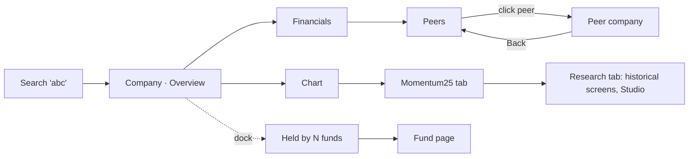
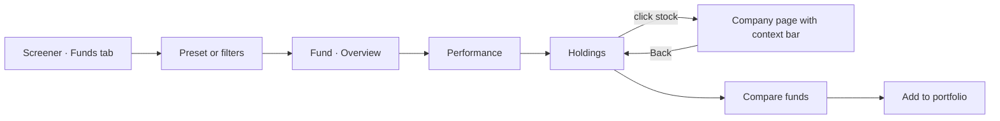
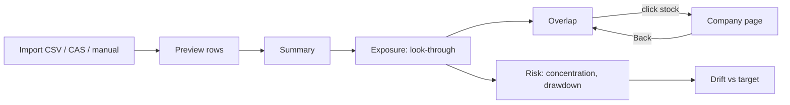

# 07 — UX Flows and Screen Specifications

> Part of the [Wickstreet 2.0 blueprint](README.md). Status: Proposed. Builds on the workstation shell (`components/shell/WorkstationShell.tsx`), the context model of the [2026-10-19 workstation plan](../shipped/2026-10-19-tradingview-workstation-plan.md#context-model-no-forced-global-selection) and the paper/ink, sea-green identity (`--ws-ink`, `--ws-surface`, `--ws-line`, `--ws-muted`, `--ws-accent`). Clean-room rule applies.

## 1. Information architecture

Wickstreet stays one workstation. The header, search, right dock and keyboard model do not change. 2.0 adds research **pages** and dock **tabs**, not new apps.

| Area | Route | Reached from |
|---|---|---|
| Screener (Stocks · Funds · ETFs) | `/` (tab in `?tab=`) | Logo, app menu |
| Chart | `/chart/:symbol` | Every symbol, Alt+C |
| Company | `/stock/:symbol` (tabs Overview · Financials · Ratios · Peers · Chart · Momentum25 · Research) | Search, screener rows, holdings, peers |
| Fund | `/fund/:planId` (Overview · Performance · Risk · Holdings · Costs · SIP) | Search, fund screener, portfolio, "held by" |
| ETF | `/etf/:symbol` (Overview · Price vs NAV · Tracking · Holdings · Chart) | Search, ETF screener |
| Compare | `/compare/funds?plans=`, `/compare/stocks?symbols=` | Fund/company pages, screener multi-select |
| Portfolio | `/portfolio/:id` (Summary · Holdings · Exposure · Overlap · Performance · Transactions) | App menu |
| Existing research | `/studio`, `/historical`, `/backtest`, `/validation`… | App menu (unchanged) |

**Right dock tabs** (existing pattern): Watchlist, Alerts, Assessment, plus **Fundamentals** (key metrics of the current symbol) and **Held by** (funds holding the current symbol). The chart stays the biggest thing on the chart route; research pages use the full main area.

**Search** returns mixed results with a type chip: `EQ`, `ETF`, `MF`. Typing filters all three; chips above the results narrow to one type. Funds match on scheme name, AMC and plan code. Results group by type, five each, "more" expands.

## 2. Context rules

1. **`from` chain.** Every link from one research view to another adds `from` (same-origin, validated by `safeReturnPath`). The destination shows a **context bar**: "From *Fund X › Holdings* ← Back". Back restores tab, disclosure, filters and scroll row.
2. **`as_of` follows the user.** If a page has `as_of` (replay, historical screen, historical disclosure), every link it makes carries it. A sea-green "As of 12 Mar 2022 ×" chip sits in the header; × returns to latest.
3. **Selections are local.** No hidden global "current fund". The URL is the state, so a link reproduces the view.
4. **Asset type is explicit.** An ETF page never shows the Momentum25 panel; a stock page never shows NAV metrics.

## 3. Journeys

### 3.1 Stock research



Discoverability: the Overview's metric strip links each metric to its Ratios chart; "Compare with peers" is a button on Overview; the Momentum25 status chip on Overview opens the Momentum25 tab.

### 3.2 Mutual-fund research



Discoverability: each fund row in the screener has a checkbox; selecting 2–5 shows "Compare 3 funds" in the table header. The Holdings tab's top line is a sentence ("62 stocks; top 10 make up 48%") with "See overlap with your portfolio" when a portfolio exists.

### 3.3 Portfolio intelligence



Discoverability: an empty portfolio page shows three large choices (Import CSV, Import CAS, Add manually) with the accepted formats. After import the Summary leads with three sentences: value and XIRR; the biggest look-through exposure; the highest fund overlap.

## 4. Screen specifications

Geometry follows the existing compact workstation: 13 px body text, 28 px table rows, 8 px grid, `--ws-line` 1 px rules, `--ws-accent` for focus, selection and positive emphasis only. Numbers are tabular and right-aligned; units sit in column headers, not cells. Negative numbers use a minus sign and `--ws-ink` (no red/green value colouring outside charts).

### 4.1 Company · Overview (desktop ≥ 1280 px)

```text
┌ header: ☰ wickstreet.  [Search ⌘K]   As of: Latest                                 ┐
├──────────────────────────────────────────────────────────────────────┬─────────────┤
│ ← From Screener › Quality in momentum                                 │ DOCK        │
│ ABC Ltd  ABC · NSE · INE123A01016        ₹1,248.60  +1.2%  21 Oct 2026│ Watchlist   │
│ Chemicals › Specialty Chemicals  ·  Formerly "ABC Organics" (to 2019) │ Alerts      │
│ [Overview] Financials  Ratios  Peers  Chart  Momentum25  Research     │ Assessment  │
├──────────────────────────────────────────────────────────────────────┤ Fundamentals│
│ Mcap ₹42,310cr │ PE 48.1 │ PB 9.2 │ ROCE 31.4% │ ROE 24.0% │ D/E 0.04│ Held by     │
│ Sales 3Y 14.2% │ Profit 3Y 22.8% │ Div yld — (needs dividends)       │             │
├───────────────────────────────┬──────────────────────────────────────┤             │
│ PRICE (1Y line, mini)         │ MOMENTUM25   ✓ Qualified · Rank 4    │             │
│ ▁▂▃▅▆▇█▇▆▇█   Open chart ›    │ RS 93 · Trend template 8/8  Details ›│             │
├───────────────────────────────┴──────────────────────────────────────┤             │
│ STRENGTHS                        │ WATCH POINTS                       │             │
│ • ROCE above 20% in each of 3 yrs│ • CFO < half of profit over 3 yrs  │             │
│ • Almost no debt (D/E 0.04)      │                                    │             │
├──────────────────────────────────┴───────────────────────────────────┤             │
│ ABOUT  Makes …  (from source, 3 lines, "more")                        │             │
│ Data: results to Q1 FY27 (published 8 Aug 2026, consolidated) · prices│             │
│ to 21 Oct 2026 · source: <operator label> · data_version 4be1…        │             │
└──────────────────────────────────────────────────────────────────────┴─────────────┘
```

- Each metric cell: label (muted), value (ink), a tooltip with formula, inputs and state reason. `NM`/`NA` render as "—" plus a reason in the tooltip and an `aria-describedby` text.
- The metric strip wraps to 2 columns on tablet, 1 on phone.
- Loading: skeleton bars in the metric strip; the header renders from search data at once. Error: an inline panel per section ("Financials could not load. Retry."); the rest of the page still works. Empty (no fundamentals imported): one panel "No company financials yet. Import them on the Data page." linking to `/data#fundamentals`.

### 4.2 Company · Financials

```text
[Quarterly] Half-yearly  Annual    [Consolidated] Standalone    Periods: 8 ▾    ⤓ CSV
                                Q2 FY25  Q3 FY25  Q4 FY25  Q1 FY26 … Q1 FY27   YoY
Revenue from operations           1,402    1,455    1,610    1,498 …   1,712  +14.3%
  ▸ Other income                     22       19       31       18 …      24
Total expenses                    1,150    1,190    1,301    1,221 …   1,377
EBITDA (derived)            ⓘ       296      301      357      312 …     372  +19.2%
…
PAT to owners                       201 •    210      262      221 …     268  +33.3%
EPS (diluted, ₹)                   12.4     12.9     16.1     13.6 …    16.5
Filed                             12 Nov   10 Feb   15 May   7 Aug  …  8 Aug 26
```

- `•` marks a restated cell: tooltip "Restated on 10 Feb 2025: was 196, now 201 (Q2 FY25)".
- Column header click shows the filing: date, basis, audit status, source reference.
- Sticky first column; horizontal scroll inside the grid only, never the page.
- `as_of` banner when set; later columns are absent, not greyed.

### 4.3 Company · Peers

Table per [03 §1.5](03-product-specs.md#15-peer-intelligence), then a scatter (x and y pickers). Outlier cells carry a small "outlier" tag with the reason in text, not colour only. Footer: "Median excludes 3 peers with no filing in 6 months".

### 4.4 Fund · Overview and Performance

```text
← From Screener › Funds › Consistent large-cap
Fund X Large Cap Fund — Direct Growth           [Direct ▾][Growth ▾]   ☆ Watch  + Portfolio
AMC Y · Large Cap · Benchmark: Nifty 100 TRI · Risk level (as disclosed): Very High
NAV ₹84.21 (21 Oct 2026) · AUM ₹31,420 cr (Sep 2026) · TER 0.62% (Regular 1.58%)
Exit load: 1% if sold within 12 months · Min SIP ₹100 · Managers: A (since 2019), B (2023)
[Overview] Performance  Risk  Holdings  Costs  SIP

GROWTH OF ₹10,000  [1Y 3Y 5Y 10Y Max]  ☑ Benchmark TRI  ☑ Category median
(line chart, lightweight-charts, same crosshair and keyboard as /chart)

             1M    6M    1Y     3Y     5Y     10Y
Fund        1.2%  8.4%  18.1%  15.2%  17.9%  14.1%
Benchmark   1.0%  7.9%  16.4%  14.0%  16.8%  13.2%
Category    1.1%  8.0%  17.0%  14.6%  17.1%  13.5%
Rank        —     —     9/31   7/29   5/27   4/21
3Y+ returns are yearly (CAGR). Shorter returns are not annualised.

HOW OFTEN IT BEAT ITS BENCHMARK  Every 3-year period since 2016: 71% (1,712 of 2,411)
(box plot of rolling 3Y CAGR: fund vs benchmark vs category)
```

If no TRI is imported, the benchmark row reads "Nifty 100 (price index, excludes dividends)" with a ⚠ and a link to the Data page.

### 4.5 Fund · Holdings

```text
Portfolio as of 30 Sep 2026 · published 9 Oct 2026 · 13 days old   [Disclosure: Sep 2026 ▾]
62 stocks · top 10 = 48.2% · effective number of holdings 31 · cash 3.1% · unreported 0.4%

ASSET MIX ▇▇▇▇▇▇▇▇▇ Equity 96.5  ▏Cash 3.1 ▏Other 0.4
SECTOR (bars)                     MARKET CAP  Large 88% · Mid 9% · Small 0% · Other 3%

  Stock            Weight   Δ qty vs Aug   Sector             M25    Held since
  HDFC Bank         9.8%    —              Banks              —      Mar 2019
  ABC Ltd           4.2%    +12% ▲         Specialty Chem.    ✓ 4    Jan 2024   ›
  …
  New this month: DEF, GHI     Exited: JKL
```

Row click → company page with the context bar (§2). The `M25` column shows the stock's Momentum25 status from the production run of the same date as the page's `as_of`.

### 4.6 Compare funds

Five columns maximum, sticky label column. Each section starts with one generated sentence (deterministic template, no free text). The overlap matrix is a small table, not a heat map, with each cell as "41%". A ⚠ line lists any plan-type or disclosure-date mismatch.

### 4.7 ETF

Overview strip: index, TER, AUM, 20D median traded value, premium/discount today. **Price vs NAV** tab: two lines on one chart plus a premium/discount histogram; **Tracking** tab: tracking difference by year, tracking error 1Y with the SEBI definition shown in one sentence. Bid-ask: "Not available on end-of-day data."

### 4.8 Portfolio · Summary and Exposure

```text
My portfolio · value ₹24.8 L · invested ₹19.2 L · XIRR 14.6% (benchmark XIRR 12.9%) · 21 Oct 2026
"Your biggest real exposure is HDFC Bank at 7.9%: 1.2% direct and 6.7% through 4 funds."
"Fund X and Fund Z overlap by 41% of Fund X's money."

[Summary] Holdings  Exposure  Overlap  Performance  Transactions
ALLOCATION  Equity 52% · Mutual funds 41% · ETF 5% · Cash 2%

EXPOSURE (look-through)                         Direct   Via funds   Total   % of value
  HDFC Bank                                     ₹0.30L   ₹1.66L      ₹1.96L  7.9%
  ABC Ltd                                       ₹0.75L   ₹0.21L      ₹0.96L  3.9%
  …
  Fund W — holdings not available                         ₹0.40L      ₹0.40L  1.6%
  Unreported / cash in funds                                           …
Based on portfolios published up to 9 Oct 2026; actual fund weights move daily.
```

### 4.9 Data page additions (`/data`)

One card per dataset: rows, latest business date, latest import, source label, reconciliation flags, "Import file…" (or the CLI command). Licence notes link to [04](04-data-sources.md). This is where empty states point.

## 5. States, accessibility, responsiveness

| Concern | Rule |
|---|---|
| Loading | Header and labels render at once; numbers skeleton; never a full-page spinner |
| Empty | Says what is missing and the one action that fixes it |
| Error | Per-section, with Retry and the request id; the rest of the page works |
| Stale data | A muted line with the date; amber `⚠` only when older than the dataset's expected cadence |
| Keyboard | Tabs follow the ARIA tablist pattern (←/→ when the tab strip has focus); tables with ↑/↓; `Enter` opens; `Esc` closes popovers; Alt+C opens the chart for the current symbol or row. No new single-letter keys, because a typed letter opens symbol search ([keyboard shortcuts](../../current/reference/keyboard-shortcuts.md)). `?` lists shortcuts. |
| Screen readers | Tables are real `<table>` with `<th scope>`; charts have a data-table toggle; states (`NM`/`NA`) are text, not icons alone |
| Contrast | WCAG 2.2 AA in both themes; the accent never carries meaning alone |
| Phone (< 640 px) | Tabs become a select; tables show 3 key columns plus "more"; the dock becomes a bottom sheet (existing behaviour) |
| Tablet | Two-column metric strip; dock collapsible |
| Themes | Only `--ws-*` tokens; no new colours except a chart palette validated in both themes |

## 6. Wireframe acceptance

Each phase's E2E suite captures the screens above in light and dark at 1440, 1024 and 390 px on synthetic fixtures (`E2ECANDLE`-style fixtures for funds and companies), and the screenshots go to `audit-evidence/w2/<phase>/` for owner sign-off, as in Phase B.
