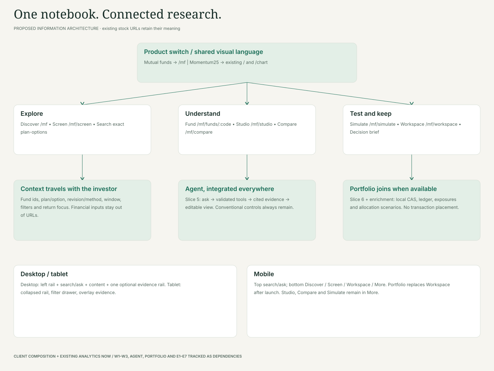
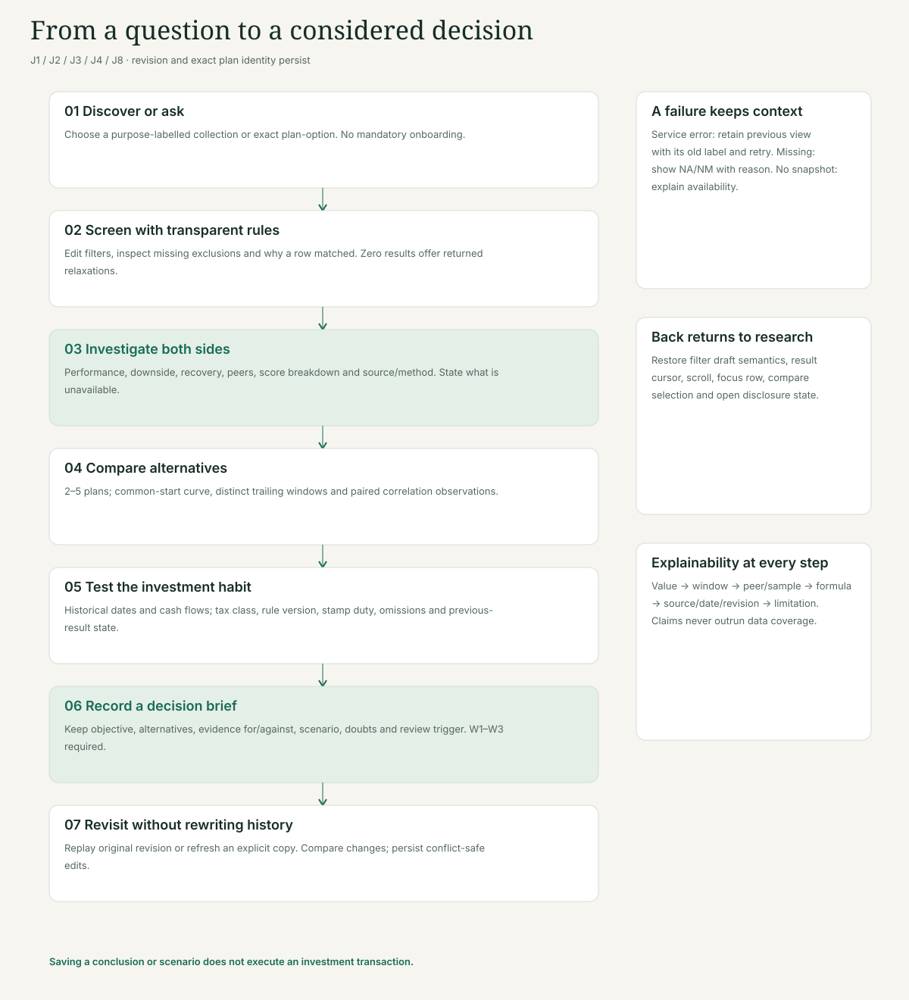
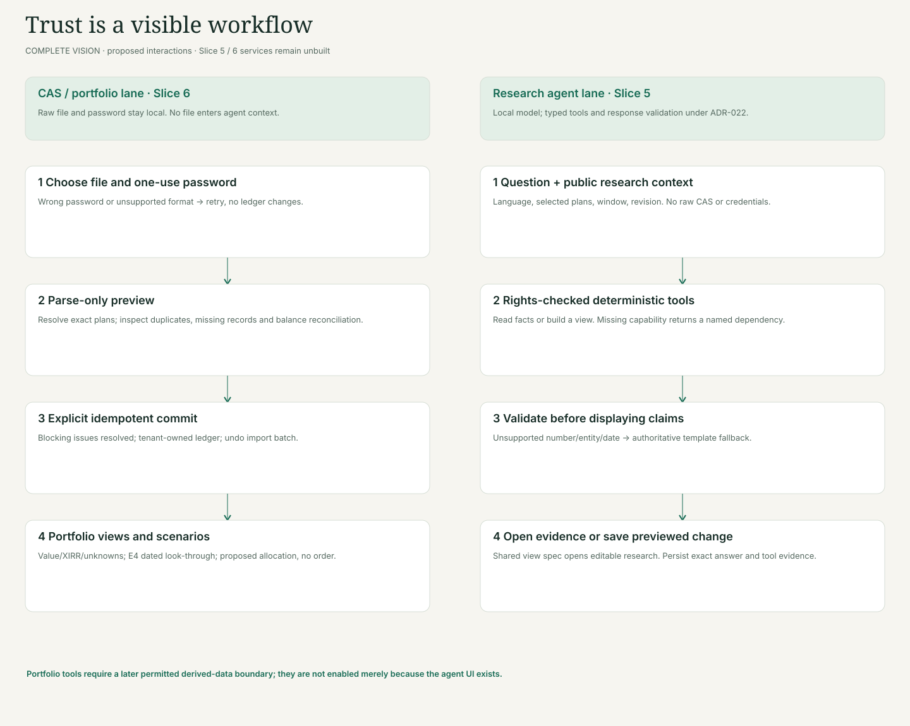

# 07 · Navigation and interaction flows

These diagrams are local vector artefacts. Their editable Mermaid sources sit beside them. The wireframe renderer regenerates all diagrams without a network call or third-party package.

## Information architecture

[Full SVG](flows/navigation.svg) · [Mermaid source](flows/navigation.mmd)

The product switch preserves Momentum25. The MF context travels across conventional research and the future agent. Portfolio joins the visible navigation when its services ship.

## Research loop

[Full SVG](flows/research-loop.svg) · [Mermaid source](flows/research-loop.mmd)

Discover, Screen, Investigate, Compare, Simulate, Personalise and Decide are one loop. Empty/error responses retain the user's question; original evidence is distinct from a refreshed copy. The brief records a research conclusion, not an order.

## Portfolio and agent boundaries

[Full SVG](flows/cas-agent-boundaries.svg) · [Mermaid source](flows/cas-agent-boundaries.mmd)

CAS parsing, preview and commit remain local. The agent uses typed, rights-checked tools and validated citations. It cannot gain access to raw CAS by opening the Portfolio screen. Later portfolio-derived tools need the Slice 6 boundary and approved methods.

The SVG diagrams emphasise the main flow; Mermaid sources include decision and retry branches. Detailed UI states and contracts are in [03](03-screen-contracts.md), not inferred from a happy-path arrow.
