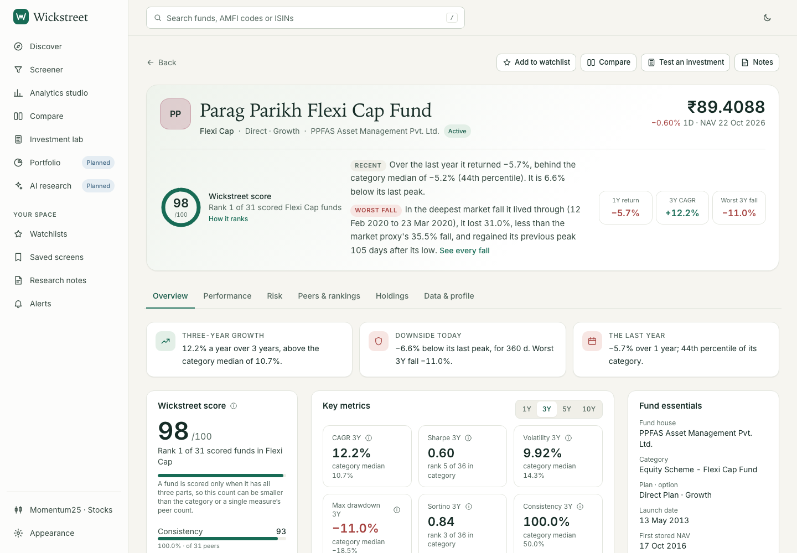
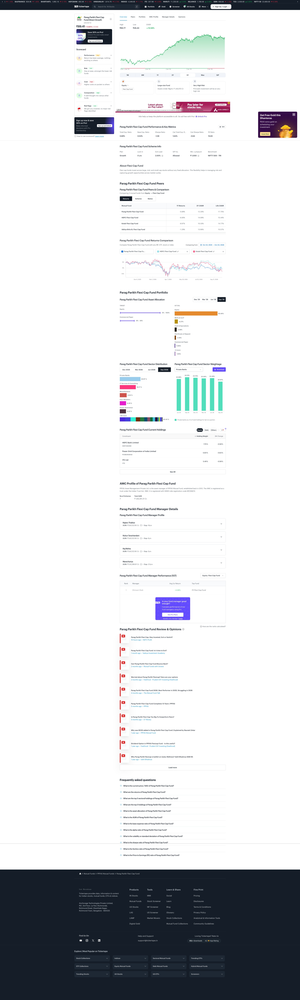
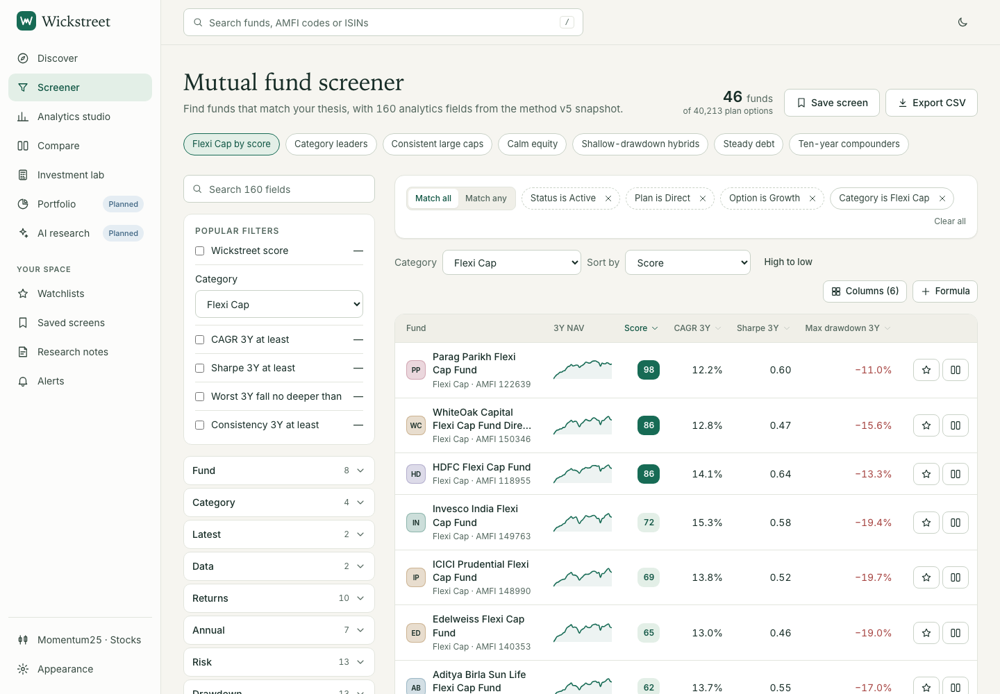
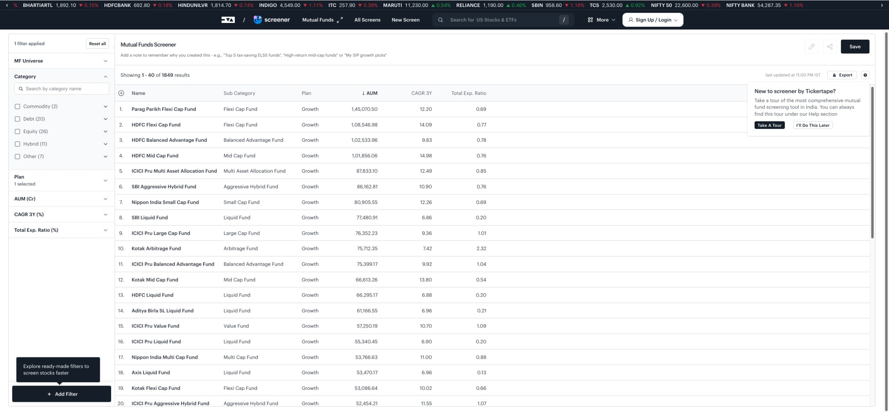
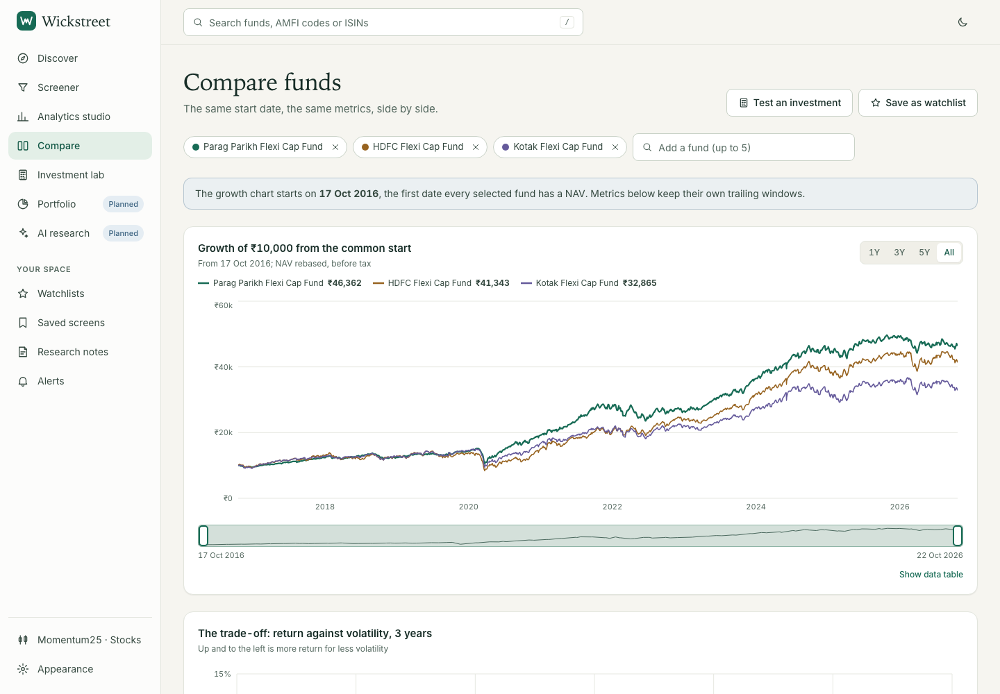
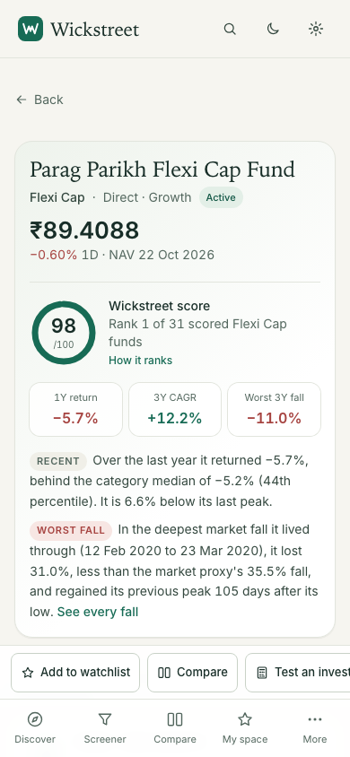

# Wickstreet 2.0 vs Tickertape — Mutual Fund Competitive Benchmark

**Independent review · 24 October 2026 · Mutual funds only**  
**Verdict: Wickstreet does not surpass Tickertape today.** Tickertape remains the more complete investment-research product; Wickstreet is stronger in historical NAV analysis, explainable peer ranking, scenario simulation, and visual craft. The gap is material: Wickstreet cannot yet connect those strengths to costs, official benchmarks, actual holdings, and an investor’s whole portfolio.

**Weighted score:** Wickstreet **7.3/10**; Tickertape **7.6/10** (including currently advertised Pro capabilities; confidence is lower where access was gated). Wickstreet’s 7.3 comes from the benchmark’s feature-completeness and decision-support weights, not a retreat from the previous **7.8** acceptance score: that score used a different framework, including engineering quality and a 25% visual-design weight. The preceding review series was 6.9 → 7.2 → 7.8 under that other framework. A 7.8 there and 7.3 here are not directly comparable.

**Local-app follow-up, 24 October 2026:** The comparison above remains tied to the accepted artifact and public Tickertape inspection described in the original review; it does not certify broad parity. Subsequent local verification confirms Wickstreet already has a working AMFI Facts & Costs profile and a side-by-side cost row, including TER and AUM. The current UI now displays TER filing dates and the latest riskometer report date separately from its value-change history. This corrects the earlier characterization of E1 as absent from the decision path. E1 remains partial: coverage and per-field source/date context vary by scheme and are not consistent in every screen. The current 390×844 cold-load trace meets the three-route 3s LCP / 0.10 CLS budget in an independent rerun, correcting the older 7–8s local result. Independent 320px review confirms the action bar is keyboard-scrollable, keeps actions reachable, and does not cause page-level overflow. Compare now preserves its period and data revision within that route, and pins its overlap request to the same revision; full cross-route context remains unfinished. See the [updated execution ledger](../../execution-ledger.md) for live API/UI evidence; this follow-up does not change the Tickertape inspection or award unverified parity.

Tickertape is strongest when a researcher needs the current facts around a scheme: TER, AUM, exit load, minimum investment, stated benchmark, portfolio mix, holdings, sector weights, and manager information are on the public PPFAS fund page. Its screener documents over 50 filters and its paid membership advertises 100+ Pro filters, portfolio analysis, diversification scores, alerts and exports. Wickstreet’s distinctive advantage is asking how a fund behaved through time: point-in-time peer ranks, rolling return distributions, rank persistence, observed drawdown episodes and recovery, common-start comparisons, and historical cash-flow simulations. Its current data boundary prevents those insights from becoming a complete fund decision.

The benchmark does **not** certify the current live Wickstreet deployment: `http://localhost:8000/mf` was unavailable when checked, so I did not start the service or touch the personal workspace. The prior acceptance review verified the `c70edf6` delivered artifact; the checkout is now at `9eaabc3` with uncommitted worktree edits, so this report uses that accepted artifact’s evidence and does not certify the current source tree. A local, uncommitted tax-classification patch was present but is not demonstrably served; its behavior is not credited as verified. The only newly captured screenshots here are public Tickertape pages. Existing application changes and personal data were left untouched.

## Method and limits

Tickertape was inspected anonymously in an InPrivate Edge session on 24 October. I opened its [MF screener](https://www.tickertape.in/screener/mutual-fund), inspected the public [Parag Parikh Flexi Cap Fund Direct Growth profile](https://www.tickertape.in/mutualfunds/parag-parikh-flexi-cap-fund-M_PARO), attempted the documented 3-year rolling-return filter, and applied a Flexi Cap category filter. I did not sign in, create an account, buy Pro, or access portfolio data tied to a user. The rolling-return filter displayed a Pro gate; applying the category filter prompted sign-up before showing the filtered results. I supplemented visible features with Tickertape’s [membership page](https://www.tickertape.in/membership) and [official screener and metric guidance](https://www.tickertape.in/knowledge-base/modules/evaluating-mutualfunds/mf-screener/). Paid claims below are marked as documented, not personally exercised.

For the comparable fund, both products were read as **PPFAS Direct Growth**, with Tickertape stating NAV and holdings data as of **22 October 2026**. Its public peer table showed PPFAS 1Y −5.69% and 3Y 12.20%; HDFC Flexi Cap −6.00% and 14.09%; Kotak Flexi Cap −8.97% and 10.33%. These matched the prior Wickstreet acceptance screenshot’s rounded PPFAS 1Y −5.7% and 3Y 12.2%. The basic trailing-return result is parity, not a Wickstreet win. Tickertape also displayed PPFAS TER 0.69%, base TER 0.53%, AUM ₹1,45,070 Cr, benchmark NIFTY 500 TRI, and current holdings/sector allocation—facts the Wickstreet fund view did not have.

No matched stopwatch study or comparable cold-load trace could be run: Wickstreet was down and the public Tickertape visit used an ordinary browser/network path. Accordingly, this report does not invent task times, latency deltas, or Tickertape mobile scores from a desktop capture. The interaction notes below are observed path characteristics, not a statistically controlled usability study. A current Wickstreet search, screen edit, mobile browser, or saved-workspace journey was not rerun. Tickertape’s authenticated free and Pro states, current CAS/XIRR flow, current overlap tool, mobile web/native application, and manager-performance Pro details were not verified.

## Independent scorecard

Each score uses the requested weights. A score of 10 means a category-leading mutual-fund research experience. Tickertape’s score includes its documented Pro product because the comparison is against the complete platform, but gated functions receive lower evidential confidence and are not treated as publicly usable in the journey study. No subscription was purchased.

| Dimension | Weight | Wickstreet | Tickertape | Evidence and judgment |
|---|---:|---:|---:|---|
| Feature completeness | 20% | 6.0 | 8.1 | Wickstreet has a substantial NAV engine and calculators but lacks current costs, benchmark TRI, holdings, CAS portfolio analysis, live alerts, and the AI runtime. Tickertape’s public dossier is materially broader; its advanced filter and portfolio depth is partly Pro-gated. |
| Analytical sophistication | 20% | 8.4 | 7.8 | Wickstreet’s point-in-time ranks, consistency, rolling histories, drawdown episodes, deterioration signals, and historical backtests go beyond the public Tickertape journey. Tickertape has broad metrics, peer returns, ratios, and documented rolling/drawdown screens, but its history explanations and paid depth were not exercised. |
| UX and usability | 20% | 7.7 | 7.6 | Wickstreet’s reviewed research flow is coherent and saves/replays scenarios. Context still fragments across pages and nested screener groups cannot be edited. Tickertape is discoverable and rich, but the anonymous screener hits sign-up/Pro gates and repeated promotions interrupt fund research. |
| Visual design and charting | 15% | 8.0 | 7.2 | Wickstreet’s two themes, editorial hierarchy, and analytical risk/compare charts feel more deliberately composed. Tickertape’s chart is serviceable and its page is information-rich, but the classic table/card layout, small dense labels, ad and Pro panels lower the finish. |
| Investment decision support | 15% | 6.8 | 8.0 | Wickstreet explains historical return/risk trade-offs and simulates dated cash flows, but cannot answer cost, official-benchmark, holdings-overlap, or portfolio-concentration questions. Tickertape can answer several of those at the fund level and advertises portfolio analysis; individualized portfolio features remain unverified. |
| Mobile performance and experience | 10% | 6.8 | 6.5* | Wickstreet is responsive in prior 390 px captures, but measured cold LCP was 7.1–8.3 s on a constrained profile. Tickertape’s mobile experience and LCP were not measured; 6.5 is a conservative provisional score, not a result. |
| **Weighted overall** | **100%** | **7.3** | **7.6*** | Tickertape leads by roughly 0.3 on breadth and decision context; Wickstreet wins on temporal NAV analytics and chart composition. Confidence: medium for Wickstreet (prior delivered-build evidence, localhost now down); medium-low for Tickertape (public product inspected, premium/mobile access limited). |

\*Tickertape’s mobile rating is deliberately provisional. The score is a directional product assessment, not a measured mobile-performance comparison. Its anonymous public journey would score lower on screen and portfolio completion because several controls require sign-up or Pro; no separate numeric free-tier score is claimed.

## Feature-parity matrix

“Wickstreet standing” uses the requested labels. “Not Implemented” describes the delivered Wickstreet slice, not a lack of product ambition; scope documents explicitly keep these mutual-fund capabilities in 2.0. Tickertape evidence is split between public observation and documentation.

| Research capability | Wickstreet delivered state | Tickertape evidence | Wickstreet standing |
|---|---|---|---|
| Fund lookup and category discovery | Search by scheme/name/code/ISIN; active plans rank ahead of historical plans; saved screens exist. Search was not rerun against the unavailable server. | Public MF categories, collections and screener; category taxonomy visible. Anonymous screen filtering gated on sign-up. | **Inferior** for guided/curated breadth; exact search parity **Not Verifiable** in this run |
| Screener filters and ranking | Broad typed field registry, formulas, nested boolean filters, sort and saved views. Accepted tests show the valid nested predicate returns correctly, but nested group editing remains unavailable. | Public table showed 1,849 total and 40 rows, with AUM, 3Y CAGR and TER. Official docs list 50+ filters; membership advertises 100+ Pro filters and custom screens. Rolling-return filter was Pro-gated; category filter prompted sign-up. | **Equivalent** for analytical control patterns; **Inferior** for breadth and anonymous filter access |
| Fund profile: basic returns and risk | NAV-based trailing/rolling performance, category rank, score, risk, drawdown and provenance. | Public profile shows NAV, scorecard, 1/6M/1/3/5Y/Max chart, SIP toggle, peers, ratios, TER, AUM and risk label. | **Inferior** as a complete dossier; **Equivalent** on representative trailing returns |
| TER, historical costs, AUM, minimums, exit load | TER/AUM/exit-load dataset E1 not ingested; direct-vs-regular NAV gap does not equal TER drag. | Public PPFAS page exposed TER 0.69%, base TER 0.53%, AUM ₹1,45,070 Cr, minimum lump sum ₹1,000 and exit-load terms. | **Not Implemented** → **Inferior** |
| Benchmark-relative performance | Official benchmark TRI history and scheme mapping not delivered; no benchmark alpha/beta/tracking error or capture. | PPFAS benchmark shown as NIFTY 500 TRI; profile exposes ratios and the platform documents alpha-related metrics. The historical benchmark analytics methodology was not independently recalculated. | **Not Implemented** → **Inferior** |
| Holdings, sector and portfolio composition | Monthly holdings and overlap dataset E4 not delivered; no security exposure or true look-through diversification. NAV correlation is not holdings overlap. | PPFAS page displayed asset allocation, sector distribution, quarter history, top holdings and weight changes; e.g. HDFC Bank 7.75%, Power Grid 5.60%, ITC 5.49% (as of 22 Oct). | **Not Implemented** → **Inferior** |
| Point-in-time ranks and consistency | Delivered: historical category rank, quartile persistence/transitions, rolling distributions, score decomposition and deterioration signals, subject to stated survivorship/category-history limitations. | Public peers show current trailing returns; docs describe average annual rolling return and rolling-return filter. Historical rank trajectories and full methodology were not verified. | **Superior** for explainable longitudinal peer analysis |
| Drawdown, recovery and downside history | Delivered true NAV trough/date, historical episodes, current drawdown, duration and recovery; latest acceptance independently reconstructed the −31.20% 24 Mar 2020 fall. | Max-drawdown filter is documented; current public profile did not show an equivalent dated episode/recovery investigation. | **Superior** for historical episode and recovery analysis |
| Financial visualisations | Date-labelled axes, true extrema, zoom, annual/rolling views, frontier, comparison scatter and common-start chart; no linked crosshair yet. | Public NAV chart has useful preset ranges and SIP toggle; peers/sector data are present. No chart coordination or detailed episode view was verified. | **Superior** for analytical chart interaction and visual hierarchy |
| Fund comparison | Compare 2–5 funds on common-start growth, NAV-derived risk metrics and daily correlation. No cost, holdings or official benchmark comparison. | Public peers table gives 1Y/3Y/life returns; scheme/ratio tabs and date-range return comparison. Cost and holdings are available on the fund page, but consistent side-by-side comparison was not exercised. | **Inferior** for decision breadth; **Superior** in shared-window NAV/risk analysis |
| SIP, lump sum, SWP, STP and tax | All four historical cash-flow types implemented; dated NAV, XIRR, scenario save/replay and historical tax rules. The current tax patch is unserved/unverified. Exit load and comprehensive post-tax cost comparison remain absent. | Public chart has SIP mode; no equivalent SWP/STP/tax historical simulation was verified. A 2021 Tickertape article mentioned a tax calculator, but that is historical documentation, not current proof. | **Superior** for verified historical scenario depth; tax acceptance remains conditional |
| Portfolio X-ray, concentration and XIRR | CAS import, investor XIRR, overlap and portfolio stress/goal analysis not implemented (Slice 6). | Membership currently advertises smart portfolio analysis, diversification/red-flag views and multiple demat accounts. Older Tickertape material documents MF portfolio XIRR and CSV workflows; current logged-in behavior and overlap tool were not verified. | **Inferior**; Tickertape advantage is documented, not fully exercised |
| Watchlists, saved research, alerts | Wickstreet has local notes, watchlists, saved screens, saved calculations and replay with snapshot provenance; context is not yet shared consistently across routes. Alerts/decision briefs are not implemented. | Public profile watchlist action; official Pro page advertises personalized alerts, saved/custom screens and exports. Anonymous persistence and alert behavior not tested. | **Inferior** in breadth; replay/provenance may be **Superior** in delivered Lab workflow |
| AI research and tailored guidance | AI runtime, recommendations, allocation and multilingual assistance remain planned, not implemented. | No conversational MF research assistant was verified on the public site or current membership page. | Wickstreet **Not Implemented**; Tickertape **Not Verifiable** |
| Data freshness and provenance | NAV data through 22 Oct 2026; versioned methods, snapshot revision, as-of and coverage are explicit for analytical responses. Some historical rankings use restated categories and have survivorship limitations. | PPFAS page states 22 Oct 2026 as-of dates and shows current fund facts/holdings. Source-level field lineage and point-in-time reconstruction were not verified. | **Equivalent** on visible date labeling; Wickstreet **Superior** in computational replay provenance, Tickertape **Superior** in fact coverage |
| Mobile layout and performance | Prior review captured 390/320 px responsive layouts; mobile overview density and 7–8 s cold LCP remain issues. | Current public mobile layout, native app flows and performance not tested. | **Not Verifiable** as a head-to-head result |

### What is verified, documented, and unavailable

- **Observed live:** Tickertape’s public profile displays current facts, fund/sector holdings, manager and peer sections. The public screener displays a dense result table. Some actions are explicitly gated for anonymous users.
- **Documented but not exercised:** 100+ Pro screens/filters, manager insights, portfolio analysis, diversification score, alerts, exports and multiple demat accounts on the [membership page](https://www.tickertape.in/membership). Historical Tickertape materials describe XIRR in its MF portfolio. These are included as advertised capabilities with lower confidence.
- **Not verified:** current authenticated free tier, Pro details, current holdings overlap tool, current in-product tax calculator, current portfolio XIRR/CAS import, AI, and native/mobile workflows. No absence is inferred from an anonymous screen where a sign-in gate blocked access.
- **Wickstreet built vs planned:** its NAV ranks, rolling/drawdown analytics, calculators, comparison and local research workspace are in the delivered slice. E1 fund facts/costs, E3 benchmark TRI, E4 holdings, E5 IDCW total returns, Slice 5 AI, Slice 6 portfolio intelligence and W2/W3 alerts/decision briefs remain unimplemented. The accepted [scope](../../20-wickstreet-2.0-complete-mf-scope.md) says these are still Wickstreet 2.0, not optional scope exclusions.

## Matched research journeys

These are task-level findings from the latest saved Wickstreet acceptance evidence plus current public Tickertape interaction. They are not same-session timed tests. Interaction counts and completion time were not captured consistently across products, so no numeric time or click advantage is claimed.

| Task | Wickstreet evidence and outcome | Tickertape evidence and outcome | Comparative result / effort |
|---|---|---|---|
| **Beginner: find a suitable fund in a category** | Discover/search and a one-category screener are present; exact name/code/ISIN lookup and current-plan ordering were previously browser-verified. The screen can be saved. Current execution could not be repeated. | Category collections and a broad screener are easy to find. Opening the screener showed results; applying Flexi Cap triggered sign-up before filtered results. | Tickertape offers more entry points; Wickstreet’s saved screen is more usable without a remote account. Anonymous Tickertape task only partially completed. Suitability itself is not established by a category screen on either product. |
| **Advanced: find consistent, not just recent, performers** | Point-in-time monthly ranks, quartile persistence/transitions, rolling return percentiles and deterioration signals support the requested question. The score parts can be inspected. | Peer table provides trailing 1Y/3Y/life returns; average annual 3Y rolling return is documented, but the live filter showed a Pro gate. Historical rank persistence was not visible. | Wickstreet leads on longitudinal consistency. Tickertape’s public peer list is quicker for a simple trailing-return shortlist. |
| **Compare candidates on performance, risk and cost** | Three-fund PPFAS/HDFC/Kotak view uses common dates, ₹10,000 growth values, risk-return scatter and correlation. TER, exit load and benchmark columns are absent. | Public profile peer table returns PPFAS/HDFC/Kotak side by side; TER, AUM, benchmark and ratios are present elsewhere on the same fund page. | Tickertape completes more of the decision comparison. Wickstreet gives the better common-period NAV investigation but cannot resolve the cost trade-off. |
| **Investigate a large fall and recovery** | Risk view exposes the deepest −31.20% fall on 24 Mar 2020 and episode/recovery evidence; independent API reconstruction in acceptance matched it. | Max-drawdown filtering is documented; public profile had no equivalent dated episode/recovery narrative in the reviewed flow. | Wickstreet’s clearest analytical win. Tickertape still has documented screening support for max drawdown. |
| **Evaluate SIP outcomes and timing** | Historical SIP uses NAV dates, XIRR, step-up and start-month distributions; saving/replay of SIP, lump-sum, SWP and STP was independently exercised in the prior review. Tax class for overseas/thematic funds is not credited until the unserved patch is tested. | Public profile offers a SIP chart mode. No same-date, same-cash-flow simulation, SWP/STP or tax-aware history was verified. | Wickstreet is substantially deeper for historical what-if analysis; not yet complete on exit loads and all tax classifications. |
| **Assess concentration and diversification** | Cannot inspect actual fund holdings or look through to a portfolio; it only has NAV-return correlation, which is not exposure overlap. | Public PPFAS profile shows holdings, weights, sectors, asset mix and quarter-by-quarter allocation. Personal portfolio analysis is Pro-documented but was gated. | Tickertape wins fund-level concentration; neither completed an observed personalized multi-fund overlap task. |
| **Understand why one fund ranks higher** | Score components and category-relative evidence can be inspected, with point-in-time ranks and caveats; this is a real differentiator over one-number scores. | Public scorecard gave high-level labels such as performance/risk/cost/composition/red flags. Deeper insights were behind Pro. | Wickstreet is more transparent about its NAV score; Tickertape has broader inputs but the evidence behind its public label is less inspectable. |
| **Complete research through a decision** | Can go from screen to fund analysis, compare and simulate, then save/replay—but periods and fund sets do not reliably persist, and costs/benchmark/holdings are missing. | Has a richer fund dossier, peers and holdings. Anonymous screener filters gate, and private portfolio/recommendation/calculator steps were not accessed. | Neither public workflow was proven end-to-end. Wickstreet is closer to a reproducible personal research notebook; Tickertape is closer to a complete fund information surface. |

### Performance comparison

| Measure | Wickstreet latest accepted evidence | Tickertape in this review | Conclusion |
|---|---|---|---|
| Cold mobile LCP | Three constrained 390×844 runs: Discover median 7.104 s, Fund Overview 8.256 s, Lab 7.072 s; 4× CPU, 150 ms latency, cache disabled, 200 kB/s down, 93.75 kB/s up. | No matched trace or mobile viewport run. | Wickstreet’s measured cold rendering is too slow for a premium mobile product. No relative TT speed claim. |
| Initial JS / transfer | 657,896-byte uncompressed entry; total decoded route JS about 1.17–1.20 MB; served without content encoding in that acceptance measurement. | No comparable bundle/transfer measurement. | Wisk has a concrete optimization target; relative size unknown. |
| Search latency | Async stale-result protection passed; test intentionally delayed a response by 2.5 s. No production p50/p95. | Search response time not instrumented; a broad query submission opened a Parag Parikh Arbitrage page, so exact matching was not sufficiently isolated to score. | Search latency and relevance cannot be ranked reliably. |
| Filter latency | No new run; prior acceptance checked predicates over 100 results and saved-screen behavior. | Filtered category attempt was stopped at the sign-up gate; Pro rolling filter stopped at the Pro gate. | No computation-latency comparison possible. |
| Chart interaction | Prior accepted checks validated date-valued zoom, extrema and table values; response/INP was not recorded. | Time-range controls and charts are present; interaction latency was not measured. | No speed comparison. Wickstreet has more analytical interactions; latency unknown. |

## Visual comparison

The Wickstreet references below are the latest accepted desktop/phone captures. Tickertape captures are anonymous public pages from this benchmark. They are representative rather than pixel-matched: viewport, page length and capture method differ. Screenshots are linked locally; previous 155 MB audit evidence is referenced, not duplicated.

| Wickstreet — Fund Intelligence | Tickertape — PPFAS fund page |
|---|---|
|  |  |

| Wickstreet — MF screener | Tickertape — MF screener |
|---|---|
|  |  |

| Wickstreet — common-start comparison | Wickstreet — mobile overview (phone quality; Tickertape mobile was not captured) |
|---|---|
|  |  |

Wickstreet’s paper/ink and Monsoon themes are distinctive, calm and consistent across light/dark captures. Risk opens with the historical event and its true trough; the compare chart uses common dates, common ₹10,000 origin and a return-risk map. This is closer to “TradingView interaction with editorial analysis” than Tickertape’s current chart/card composition. The weakness is consistency of research focus: the Fund Intelligence Overview repeats some score/return/downside content between its hero, insight strip and cards, while the main chart sits below the initial viewport. On mobile the overview identity/score/narrative occupies most of the first screen; dense information becomes a long scroll.

Tickertape wins information breadth and real-world utility in the profile: a user can go from NAV to TER/AUM/benchmark, holdings, sector exposure, peers and manager information on one page. That density is also its visual cost. Smaller table text, advertising and repeated Pro prompts compete with analysis, and deeper score explanations are gated. The screener fits many rows and controls on screen; it is denser than Wickstreet, though its anonymous flow makes filtering incomplete. Wickstreet is more premium in composition; Tickertape is more complete at the moment the investor asks “what do I own and what does it cost?” Neither is yet the combined target product.

Previous Wickstreet evidence shows real remediation rather than a cosmetic reset: compare the earlier [candidate overview](../independent-audit-2026-10-23/candidate/screens/d-fund-overview-viewport.png) with the accepted [current overview](../acceptance-review-2026-10-24/screens/d-fund-overview.png), and the omitted-trough [before](../independent-audit-2026-10-23/screens/probe2-drawdown-omitted-trough.png) with the corrected [Risk view](../acceptance-review-2026-10-24/screens/d-risk.png). The trough and evidence hierarchy materially improved; the accepted report’s remaining mobile and content-density issues still apply.

## What prevents Wickstreet from winning

### P0 — Do not present an unsupported tax class as fact

The previous acceptance review found international/thematic code 119517 silently receiving domestic-equity treatment. A local source patch now makes the broad thematic category ambiguous, but it has not been shown in the served app or independently checked. Until the exact delivered build returns the supported slab-based result (₹15,320.16 in the acceptance case) or asks for a valid class, tax output for uncertain overseas/thematic funds remains an unresolved trust gate. Tax and simulator conclusions must also include applicable exit-load assumptions when E1 data exists.

### P1 — Fund facts and portfolio evidence are missing from the decision path

Without TER history and exit-load rules, Wickstreet cannot calculate cost drag or compare the amount an investor retains. Without each scheme’s benchmark TRI, it cannot distinguish market exposure from manager contribution. Without dated holdings, it cannot identify two funds that own the same securities or sectors. These are not cosmetic fields: each can reverse an apparent ranking. The accepted Wickstreet specifications explicitly assign E1, E3 and E4 to 2.0; they are data-dependency workstreams, not out-of-scope features.

### P1 — Good analysis is not yet a continuous investigation

Fund sets, period windows and snapshot revisions do not consistently flow from Screen → Fund → Studio → Compare → Lab. The nested filter group can be executed after remediation but cannot be opened to edit a child condition. Compare/Studio chart cursors and zooms are independent. These gaps make analysts reconstruct context manually and weaken reproducibility. They are not calculation failures, but they materially limit the premium research experience.

### P1 — Mobile cold rendering misses a consumer-product bar

The 658 kB uncompressed entry and approximately 1.2 MB route JS were tied to measured 7–8 s cold LCP on a constrained phone profile. That is a real Wickstreet issue even without a fair competitor trace. The prior accepted report’s mobile overview also pushes chart/research actions below the fold. A responsive breakpoint alone is not mobile quality.

## Ten improvements with the highest user value

Priorities order trust and decision-changing evidence ahead of field-count parity or decorative polish. The criteria below are release checks, not feature aspirations.

| Rank / priority | Improvement | Measurable acceptance criteria |
|---|---|---|
| **1 · P0** | **Ship and independently verify conservative tax classification.** Close the overseas/thematic classification case; make exit-load and tax assumptions explicit. | The exact 119517 dated case on the delivered port returns `tax_class_needed` or **₹15,320.16** with a verified slab class, never ₹0 under automatic domestic-equity treatment. Run served API + browser tests for domestic equity, debt, overseas equity, index/FoF and ambiguous hybrid across rule-change dates. Save/replay preserves selected class, rule version and calculation dates. |
| **2 · P1** | **Ingest E1 fund facts and costs into every research surface.** | For each active Direct Growth fund, report coverage and `as_of` per field; target **≥95% coverage per available E1 field**, with unknown values explicitly missing and every populated value linked to a source/date. Screen, profile and compare show TER, AUM, minimum SIP/lump sum, exit load, benchmark name, manager and riskometer. Historical TER changes can be plotted and included in cost-aware comparisons; never describe NAV gap as TER. |
| **3 · P1** | **Add official benchmark TRI analytics (E3).** | For every mapped scheme, store dated benchmark identity and licensed TRI provenance. Independently reproduce 1/3/5Y benchmark-relative return, alpha/beta, tracking difference/error, information ratio and upside/downside capture on aligned dates. Every view states index, date range, data coverage and method; no category proxy is labelled an index. |
| **4 · P1** | **Add dated look-through holdings and concentration (E4).** | Import monthly equity/debt/other disclosures with source dates and reconciliation status. Show top holdings, sector, asset and issuer exposure through time; identify actual shared holdings and weighted overlap for a chosen fund set. Compare holdings as of the same reporting month, flag stale/missing disclosures, and validate overlap against an independent recomputation. Keep NAV correlation separately labelled. |
| **5 · P1** | **Deliver a private local portfolio X-ray (Slice 6).** | Import supported CAS files without transmission; show a visible local-only/privacy boundary. Transaction-level units and flows reconcile to statement totals; independently calculated portfolio XIRR matches within **1 bp** on golden cases. Show cost/tax lots, look-through concentration, overlap, asset allocation, and historical stress against the user’s actual holdings. Missing transactions never silently become zero. |
| **6 · P1** | **Make rankings and research conclusions robust and explainable.** | For each rank, expose peer group, point-in-time member count, period, percentile, score component weights, missing-data treatment, snapshot, and category-history/survivorship caveat. Rebuild sampled historic ranks using only information available at that date; dead funds and changed categories are surfaced. A user can identify which measurable evidence caused fund A to outrank B. |
| **7 · P1** | **Carry one research context across the workflow and charts.** | Fund set, plan/option, date range and pinned/latest revision persist through Screen → Fund → Studio → Compare → Lab, Back and reload. A shared crosshair gives the same date/value across compatible charts and keyboard navigation; missing dates are explicit. A two-fund, non-default-period, pinned-snapshot journey reopens with exact values and no silent context substitution. |
| **8 · P1** | **Finish the advanced screener as an editable research tool.** | Open an ANY/ALL group, edit/remove either child, change its operator, cancel without mutation, save/reopen with identical semantics, and retain universe gates. Show filter coverage and unknown treatment before sorting. Support readable dense table and beginner view without making the default list sparse; test formula/unit errors and result counts against an independent query. |
| **9 · P1** | **Meet a mobile performance budget and redesign the first-screen hierarchy.** | On 390×844 with cache disabled, 4× CPU, 150 ms latency and 200 kB/s down, three cold runs per route achieve median **LCP ≤3.0 s**, **CLS ≤0.10** for Discover, Fund Overview and Lab; report encoded/decoded transfer and INP. At first render on Fund Overview, show fund identity, as-of date, key decision evidence and a reachable chart/action without a full-screen hero. Verify touch zoom/crosshair and no horizontal overflow at 320 px. |
| **10 · P1** | **Build a local, evidence-grounded multilingual research copilot.** | Hindi/Hinglish/English questions can generate screens and compare funds using the same analytics API. Every claim links to the underlying metric, fund, period, snapshot, formula and source; unknown coverage returns “not enough data.” Repeated prompts on a pinned snapshot are reproducible. Evaluate at least 50 beginner and advanced MF questions with zero invented TER/benchmark/holdings facts and a visible distinction between historical evidence and personalized projection. |

## Strategic differentiation: build the decision notebook, not another metric catalog

Wickstreet should not try to win by matching Tickertape’s filter count. The defensible product is a **private, reproducible investment-research notebook** that remembers exactly what the investor saw and can explain what changed. Its advantage should combine:

1. **Time-aware evidence:** historical peer ranks, consistency and drawdown/recovery, with every conclusion pinned to the data and method available at that time.
2. **True portfolio look-through:** show whether two schemes actually duplicate securities, sectors and risk exposures, and how those overlaps change with monthly disclosures. This is different from return correlation.
3. **Decision consequences:** apply costs, exit loads, taxes and actual cash-flow timing to a specific investor’s own portfolio and goals; show assumptions and uncertainty at the result.
4. **A replayable research trail:** save a question, filters, fund set, period, snapshot and reasoning; later show which data changed the conclusion.
5. **Evidence-first AI in Indian languages:** translate a question into a screen or simulation, cite each fact to a dated source and analytic method, and refuse to fill gaps with fluent guesses.

Tickertape currently answers “what does this scheme hold, cost and return?” more completely. Wickstreet can surpass it by answering **“how robust is this fund through regimes, what does it add to my existing portfolio, what would it have meant for my cash flows after costs and taxes, and what evidence changed the recommendation?”**—with a traceable answer, local privacy and a saved replay. That is a meaningful user outcome beyond parity.

## Sources and supporting evidence

**Local evidence:** [latest Wickstreet acceptance report](../acceptance-review-2026-10-24/REPORT.md); [accepted Wickstreet 2.0 scope](../../20-wickstreet-2.0-complete-mf-scope.md); [analytics expansion specification](../../21-analytics-expansion-v4.md); [original independent audit](../independent-audit-2026-10-23/REPORT.md); [Claude Opus remediation report](../independent-remediation-2026-10-24/REPORT.md); [Codex design atlas](../wireframes/index.html); [owner reference A](../audit-2026-10-23/refs/owner-ref-a-app-screens.png); [owner reference B](../audit-2026-10-23/refs/owner-ref-b-visual-proposal.png).

**Tickertape public evidence (opened 24 Oct 2026):** [PPFAS Direct Growth profile](https://www.tickertape.in/mutualfunds/parag-parikh-flexi-cap-fund-M_PARO); [MF screener](https://www.tickertape.in/screener/mutual-fund); [current membership capabilities](https://www.tickertape.in/membership); [MF screener filter guide](https://www.tickertape.in/knowledge-base/modules/evaluating-mutualfunds/mf-screener/); [rolling returns](https://www.tickertape.in/knowledge-base/modules/evaluating-mfs/returns/); [portfolio composition](https://www.tickertape.in/knowledge-base/modules/evaluating-mutualfunds/portfolio-composition/); [scheme information](https://www.tickertape.in/knowledge-base/modules/evaluating-mutualfunds/scheme-info/); [risk/ratio definitions](https://www.tickertape.in/knowledge-base/modules/evaluating-mutualfunds/ratios/); [historical MF portfolio and XIRR article (2023)](https://www.tickertape.in/blog/mutual-funds-portfolio-on-tickertape/); [historical overlap article (2021/22)](https://www.tickertape.in/blog/mutual-fund-overlap/). Older help/blog pages are used only as documentation of advertised or historical capability, not proof of current gated behavior.

**Screenshots saved in this folder:** `screens/tickertape-fund-profile-desktop.jpeg` and `screens/tickertape-screener-desktop.jpeg`. Wickstreet screenshots are linked from the acceptance review to avoid duplicating its evidence. No application code, personal records, or database state was changed by this benchmark; no commit or push was made.
